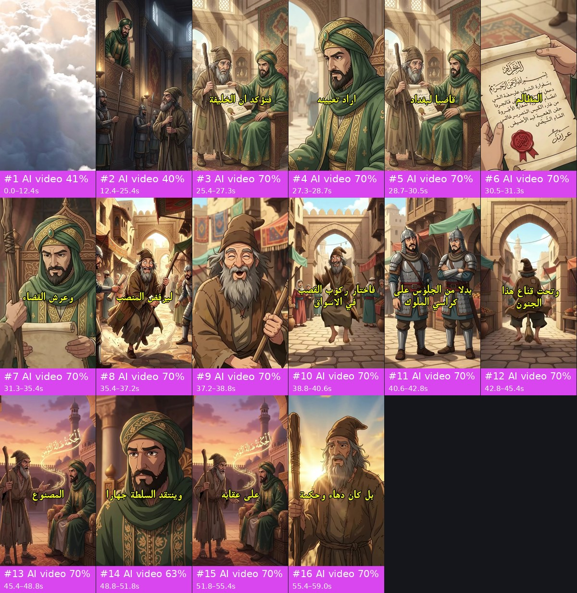
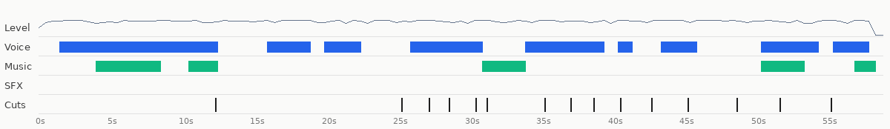

# How this video was made: dahaa.mp4

**How it was made**: Mixed production: live action or AI, to confirm 100% (48% of the duration is live action or AI, to confirm: the platform transcode erased the noise evidence, needs a VLM pass or a human look at the frames)

- 0:58 · vertical 9:16 · 16 shots, 3.7s each on average
- Confidence 57%, based on: tool measurements
- ⚠️ **Nobody has looked at the picture yet**: live action / AI / 3D / code render come from pixel statistics only and are often wrong across the board after platform transcoding. Turn on a VLM or have an agent review the shots (`rea-video review`) before remaking from this report
- ⚠️ 18 points are uncertain, see “Open questions”

<!--mix-->



# Part one · Breakdown: how this video is built

## At a glance: picture, packaging, sound

Any short video splits into three layers: the picture, what is laid on top of it (subtitles, styled text, stickers), and the sound. Remake it one layer at a time.

| Layer | In this video | How to make it | Detail |
|---|---|---|---|
| **Picture** (base) | AI-generated video 16 shots | AI in 6 generations | “Remake it yourself” |
| **Packaging** (on top) | subtitle, styled text, animated sticker / GIF, graphic, static sticker, text | add in the editor: subtitles, styled text and stickers by the timeline | “Packaging layer” |
| **Sound** | voice（TTS voice-over） | voice: TTS voice-over | “Sound” |

## Content and structure

- The whole video's content was not analysed this time (needs AI image reading); subtitle text is under “Packaging layer”

- No narrative line this time (what each shot is doing in the story needs AI image reading); the “Picture” column of the shot list is a start

## Shot list

| # | Frame | Time | Picture | Camera |
|---|---|---|---|---|
| 1 |  | 0:00.0 · 12.4s | — | static (subject moves) |
| 2 |  | 0:12.4 · 13.0s | — | static |
| 3 |  | 0:25.4 · 1.9s | — | static |
| 4 |  | 0:27.3 · 1.4s | — | static |
| 5 |  | 0:28.7 · 1.8s | — | static (subject moves) |
| 6 |  | 0:30.5 · 0.8s | — | smooth move |
| 7 |  | 0:31.3 · 4.1s | — | smooth move |
| 8 |  | 0:35.4 · 1.8s | — | static |
| 9 |  | 0:37.2 · 1.6s | — | smooth move |
| 10 |  | 0:38.8 · 1.8s | — | static (subject moves) |
| 11 |  | 0:40.6 · 2.2s | — | static |
| 12 |  | 0:42.8 · 2.5s | — | static (subject moves) |
| 13 |  | 0:45.4 · 3.4s | — | static |
| 14 |  | 0:48.8 · 3.0s | — | static |
| 15 |  | 0:51.8 · 3.6s | — | smooth move |
| 16 |  | 0:55.4 · 3.6s | — | smooth move |

## Cast, scenes and props

- No cast extracted this time (needs AI image reading); shots where the face detector saw a face (person or character): #1, #3, #7–#9, #14

## Camera and lighting

- Framing: shot size medium close-up 83%, medium shot 12%, close-up 5%; subject is the in-focus region (no face; shot size is an estimate)
- Camera: fixed camera (tripod / mount / on the desk) 77%, moving camera (gimbal / handheld pan) 23%; typical move pull-out
- Lighting: three-quarter key + fill (standard set-up). Key light frame right, three-quarter front, at subject height; lighting ratio about 1.4:1 (0.5 stops); soft light (wide lit-to-shadow ramp); colour temperature warm (about 3000–4000K); background clearly blurred (shallow depth of field / portrait mode)
- (not live footage: the above describes the light in the picture, for generation prompts, not a shooting plan)
- Grade: natural (close to the original colours); normal saturation, normal contrast, normal blacks, overall warm

<details class="ref"><summary>Per-item measurements and image readings (5)</summary>

| Aspect | Item | Verdict | Sources |
|---|---|---|---|
| Framing | shot size | medium close-up | measured |
| Camera | camera support | fixed camera (tripod / mount / on the desk) | measured |
| Lighting | soft / hard | soft light (wide lit-to-shadow ramp) | measured |
| Lighting | colour temperature | warm (about 3000–4000K) | measured |
| Grade | colour grade | natural (close to the original colours) | measured |

- Note: lighting ratio, soft / hard, colour temperature and shot size are measured on the subject's pixels (the face when there is one, otherwise the in-focus region, which is an estimate); platform transcodes crush the shadows, so hardness and fill read conservative; camera angle, light source, catchlight and rim light follow the image readers. Where measurement and readers disagree, both are listed.

</details>

## Packaging layer (subtitles / styled text / stickers / sound-effect hits)

- styled text ×3 (large size, tilted, brown fill, orange fill): "068", "國R", "食"
- text label ×8: "Jl", "NOYN", "1JJ", "小", "sle L", "li" …
- Stickers / GIFs: animated sticker / GIF ×2, static sticker / image ×3
- 4 persistent layers (unchanged across cuts: lay each on once for its span, not per shot): static sticker / image 25.5–28.6s, static sticker / image 38.9–42.7s, static sticker / image 48.9–55.3s, animated sticker / GIF 51.9–58.9s

<details class="ref"><summary>text timeline (11 rows)</summary>

| Time | Kind | Text | Style | In / out | SFX |
|---|---|---|---|---|---|
| 1.50–2.10s | text label | Jl | yellow text, black outline, keywords highlighted in orange, line height 11.0% (about 211px) | type-on / hard out | — |
| 12.40–14.10s | text label | NOYN | grey text, brown outline, line height 4.5% (about 85px) | hard in / slide out | — |
| 12.50–14.60s | text label | 1JJ | yellow text, black outline, line height 10.9% (about 210px) | fade out | — |
| 17.00–17.20s | styled text | 068 | brown text, line height 9.8% (about 189px) | hard in / hard out | — |
| 27.30–28.70s | text label | 小 | orange text, keywords highlighted in orange, line height 6.6% (about 127px) | hard in / hard out | — |
| 27.30–28.70s | text label | sle L | yellow text, black outline, keywords highlighted in grey, line height 10.5% (about 203px) | hard in / hard out | — |
| 30.80–31.30s | styled text | 國R | brown text, line height 13.7% (about 262px) | hard in / hard out | — |
| 42.80–44.60s | text label | li | yellow text, black outline, brown box, keywords highlighted in orange, line height 11.6% (about 223px) | hard in | — |
| 51.00–51.80s | text label | alc | yellow text, black outline, keywords highlighted in orange, line height 10.9% (about 209px) | fade in / hard out | — |
| 51.80–54.00s | text label | mmmmmm | brown text, line height 7.3% (about 141px) | type-on / slide out | — |
| 58.00–59.00s | styled text | 食 | orange text, yellow box, line height 25.3% (about 486px) | fade in | — |

</details>

**Stickers / GIFs / picture-in-picture**

| Time | Kind | Position | Motion | Confidence | Crop |
|---|---|---|---|---|---|
| 21.20–23.40s | animated sticker / GIF | x20% y54% w60% h9% | animated | medium (appears and disappears mid-shot) |  |
| 25.50–28.60s | static sticker / image | x80% y80% w10% h14% | static | medium (unchanged across a cut) |  |
| 38.90–42.70s | static sticker / image | x45% y91% w30% h6% | static | medium (unchanged across a cut) |  |
| 48.90–55.30s | static sticker / image | x75% y43% w15% h11% | static | medium (unchanged across a cut) |  |
| 51.90–58.90s | animated sticker / GIF | x10% y77% w10% h11% | animated | medium (unchanged across a cut) |  |

- Remake: import `packaging/subtitles.srt` into your editor and put in your own words; the styled version is `packaging/overlays.ass`; find matching stickers and GIFs in an asset library

## Sound

**Voice**

- male-leaning
- Source: TTS voice-over
- Remake: TTS voice-over: CapCut text-to-speech or another TTS tool, with a similar voice and pace

**Listen to the tracks**

<!--stems-->

<details class="ref"><summary>Sound measurements and evidence</summary>



- Loudness -10.9 dBFS, peak 0.0 dBFS
- sound runs across cuts, laid in post as one bed (background changes 6.4dB at cuts vs 7.1dB within shots)
- Voice on 63% of the duration, pitch about 137.8Hz
- Voice source: TTS voice-over (TTS voice-over 64%, human recording 27%, native dialogue from the AI video model 9%)
  - Voice and background sound run across cuts: the voice-over was laid on separately in post (TTS or a human voice-over)

</details>

## Open questions

- The VLM did not run (No VLM; live action / AI / 3D are told apart from pixel statistics only, so confidence is limited. An agent that can see images: run rea-video review, look at each shot and merge with apply-review; otherwise configure a VLM (any OpenAI-compatible multimodal model, e.g. Gemini / GPT-4o / Doubao / Qwen-VL): set REA_VLM_BASE_URL, REA_VLM_API_KEY and REA_VLM_MODEL (several models comma-separated as fallbacks), then rerun with --vlm): live action / AI / 3D is decided by signal forensics alone; configure a multimodal model and rerun with --vlm, or have an agent review the frames
- Shot #1 (0.0–12.4s): Live action / stop motion or AI, to confirm: no AIGC label; 24fps-source marks appear in AI video, stop motion and cinema-camera footage alike
- Shot #2 (12.4–25.4s): Live action / stop motion or AI, to confirm: no AIGC label; 24fps-source marks appear in AI video, stop motion and cinema-camera footage alike
- Shot #3 (25.4–27.3s): AI, 24p camera footage or film / TV footage, to confirm: only frame-rate evidence (a 24fps source, which films and TV share) and no AIGC label, needs an image reader
- Shot #4 (27.3–28.7s): AI, 24p camera footage or film / TV footage, to confirm: only frame-rate evidence (a 24fps source, which films and TV share) and no AIGC label, needs an image reader
- Shot #5 (28.7–30.5s): AI, 24p camera footage or film / TV footage, to confirm: only frame-rate evidence (a 24fps source, which films and TV share) and no AIGC label, needs an image reader
- Shot #6 (30.5–31.3s): AI, 24p camera footage or film / TV footage, to confirm: only frame-rate evidence (a 24fps source, which films and TV share) and no AIGC label, needs an image reader
- Shot #7 (31.3–35.4s): AI, 24p camera footage or film / TV footage, to confirm: only frame-rate evidence (a 24fps source, which films and TV share) and no AIGC label, needs an image reader
- Shot #8 (35.4–37.2s): AI, 24p camera footage or film / TV footage, to confirm: only frame-rate evidence (a 24fps source, which films and TV share) and no AIGC label, needs an image reader
- Shot #9 (37.2–38.8s): AI, 24p camera footage or film / TV footage, to confirm: only frame-rate evidence (a 24fps source, which films and TV share) and no AIGC label, needs an image reader
- Shot #10 (38.8–40.6s): AI, 24p camera footage or film / TV footage, to confirm: only frame-rate evidence (a 24fps source, which films and TV share) and no AIGC label, needs an image reader
- Shot #11 (40.6–42.8s): AI, 24p camera footage or film / TV footage, to confirm: only frame-rate evidence (a 24fps source, which films and TV share) and no AIGC label, needs an image reader
- Shot #12 (42.8–45.4s): AI, 24p camera footage or film / TV footage, to confirm: only frame-rate evidence (a 24fps source, which films and TV share) and no AIGC label, needs an image reader
- Shot #13 (45.4–48.8s): AI, 24p camera footage or film / TV footage, to confirm: only frame-rate evidence (a 24fps source, which films and TV share) and no AIGC label, needs an image reader
- Shot #14 (48.8–51.8s): AI, 24p camera footage or film / TV footage, to confirm: only frame-rate evidence (a 24fps source, which films and TV share) and no AIGC label, needs an image reader
- Shot #15 (51.8–55.4s): AI, 24p camera footage or film / TV footage, to confirm: only frame-rate evidence (a 24fps source, which films and TV share) and no AIGC label, needs an image reader
- Shot #16 (55.4–59.0s): AI, 24p camera footage or film / TV footage, to confirm: only frame-rate evidence (a 24fps source, which films and TV share) and no AIGC label, needs an image reader
- No AI listened to the soundtrack: real voice versus TTS is inferred from the waveform; the effects were found on the separated effects track and their types are estimated from the sound. Play the stems and each effect under “Sound” to check

# Part two · Remake plan

Planned for **MiniMax H3 / H3 Max**: ≤15 s per call, several shots per call, takes reference video (3 clips, ≤15 s in all), ≤9 reference images, first / last frame, native sound. Name another model and the split, lengths and prompts are redone for it.

## Remake it yourself: do it in this order

Copy the method and the rhythm, not the pictures: keep what each part does and fill it with your own content and material.

This is a AI story short. Do the steps in this order; the detail for each is in the matching subsection below.

1. **Write the content**: one picture of your own for each of the 16 shots in the shot list
2. **Fill in the prompts**: this run had no image reading, so the shot descriptions in the units are empty; have the agent read the shots first
3. **Generate**: 6 calls (59 s), several shots each. Each shot gets one source frame for composition (subtitles erased, in `remake/refs/`), the swapped-in people, animals and products get reference images, and the prompt lists the shots in order
4. **Adapt the prompts to your model**: the prompts in this report are generic, and every model reads them differently (how shots are split, how references are addressed, how dialogue is written). Before generating, rewrite them following the official prompt guide of the model you actually use, or have the agent refine them with that model's prompting skill; notes for MiniMax H3 / H3 Max at the top of “AI generation”
5. **Voice**: the original is TTS voice-over; record it yourself or use TTS
6. **Edit**: follow the order and lengths in the shot list; the original has 16 shots at 3.7s each
7. **Subtitles and styled text**: timing and style under “Packaging layer”
8. **Put it together and compare**: hand the shots you made to the agent; it places them on the original timeline, keeps the original where yours are missing, and renders a side-by-side comparison with the original

### AI generation

**6 generations, 59 s in total**

> ⚠️ G1、G2、G3、G4、G5、G6: the prompts are still generic drafts. Rewrite them in MiniMax H3 / H3 Max's official format (or have the agent write them with that model's prompting skill) into `remake/prompts.json`, numbering images in the unit's reference order; `rea-video plan` then checks the format.

| Part | Shots | Time | Length | Prepare |
|---|---|---|---|---|
| G1 | #1 | 0.0–12.4s | 12.4s | reference images |
| G2 | #2, #3 | 12.4–27.3s | 14.9s | reference images |
| G3 | #4–#7 | 27.3–35.4s | 8.1s | reference images |
| G4 | #8–#11 | 35.4–42.8s | 7.5s | reference images |
| G5 | #12–#14 | 42.8–51.8s | 9.0s | reference images |
| G6 | #15, #16 | 51.8–59.0s | 7.2s | reference images |

<details class="ref"><summary>Why it is split this way</summary>

- Grouping: consecutive shots share a call where they fit, ≤15s per call, ≤4 shots; a long stretch is cut at a scene change first
- Inputs: the model takes no reference video: one source frame per shot (subtitles erased) fixes composition, swapped-in things get their own images
- Audio: the model can generate action sound effects and ambience along with the picture; voice-over is better done as separate TTS and mixed in, so copy and timing stay editable
- Packaging: the text label, styled text, sticker on the generated shots is post-production packaging: keep it out of the prompts (erased from source references) and lay it back on from the packaging timeline after generation

</details>

<details><summary>G1 · shots #1 · 12.4s</summary>

- reference images: source frames of shots #1 (subtitles erased)

Draft prompt (generic; rewrite it in MiniMax H3 / H3 Max's format into remake/prompts.json before generating):

```text
Generate the shots below in order in one go, hard cuts between them; each shot takes composition, size and camera from its source frame image. Vertical 9:16; three-quarter key + fill (standard set-up), soft light (wide lit-to-shadow ramp), warm (about 3000–4000K), background clearly blurred (shallow depth of field / portrait mode). No subtitles, captions or watermarks in the picture.
(no description: write one in the image review) (composition: @图片1)
```

</details>

<details><summary>G2 · shots #2, #3 · 14.9s</summary>

- reference images: source frames of shots #2、#3 (subtitles erased)

Draft prompt (generic; rewrite it in MiniMax H3 / H3 Max's format into remake/prompts.json before generating):

```text
Generate the shots below in order in one go, hard cuts between them; each shot takes composition, size and camera from its source frame image. Vertical 9:16; three-quarter key + fill (standard set-up), soft light (wide lit-to-shadow ramp), warm (about 3000–4000K), background clearly blurred (shallow depth of field / portrait mode). No subtitles, captions or watermarks in the picture.
Shot 1 (from 0.0s): (no description: write one in the image review) (composition: @图片1)
Shot 2 (from 13.0s): (no description: write one in the image review) (composition: @图片2)
```

</details>

<details><summary>G3 · shots #4–#7 · 8.1s</summary>

- reference images: source frames of shots #4、#5、#6、#7 (subtitles erased)

Draft prompt (generic; rewrite it in MiniMax H3 / H3 Max's format into remake/prompts.json before generating):

```text
Generate the shots below in order in one go, hard cuts between them; each shot takes composition, size and camera from its source frame image. Vertical 9:16; three-quarter key + fill (standard set-up), soft light (wide lit-to-shadow ramp), warm (about 3000–4000K), background clearly blurred (shallow depth of field / portrait mode). No subtitles, captions or watermarks in the picture.
Shot 1 (from 0.0s): (no description: write one in the image review) (composition: @图片1)
Shot 2 (from 1.4s): (no description: write one in the image review) (composition: @图片2)
Shot 3 (from 3.2s): (no description: write one in the image review) (composition: @图片3)
Shot 4 (from 4.0s): (no description: write one in the image review) (composition: @图片4)
```

</details>

<details><summary>G4 · shots #8–#11 · 7.5s</summary>

- reference images: source frames of shots #8、#9、#10、#11 (subtitles erased)

Draft prompt (generic; rewrite it in MiniMax H3 / H3 Max's format into remake/prompts.json before generating):

```text
Generate the shots below in order in one go, hard cuts between them; each shot takes composition, size and camera from its source frame image. Vertical 9:16; three-quarter key + fill (standard set-up), soft light (wide lit-to-shadow ramp), warm (about 3000–4000K), background clearly blurred (shallow depth of field / portrait mode). No subtitles, captions or watermarks in the picture.
Shot 1 (from 0.0s): (no description: write one in the image review) (composition: @图片1)
Shot 2 (from 1.8s): (no description: write one in the image review) (composition: @图片2)
Shot 3 (from 3.4s): (no description: write one in the image review) (composition: @图片3)
Shot 4 (from 5.3s): (no description: write one in the image review) (composition: @图片4)
```

</details>

<details><summary>G5 · shots #12–#14 · 9.0s</summary>

- reference images: source frames of shots #12、#13、#14 (subtitles erased)

Draft prompt (generic; rewrite it in MiniMax H3 / H3 Max's format into remake/prompts.json before generating):

```text
Generate the shots below in order in one go, hard cuts between them; each shot takes composition, size and camera from its source frame image. Vertical 9:16; three-quarter key + fill (standard set-up), soft light (wide lit-to-shadow ramp), warm (about 3000–4000K), background clearly blurred (shallow depth of field / portrait mode). No subtitles, captions or watermarks in the picture.
Shot 1 (from 0.0s): (no description: write one in the image review) (composition: @图片1)
Shot 2 (from 2.5s): (no description: write one in the image review) (composition: @图片2)
Shot 3 (from 5.9s): (no description: write one in the image review) (composition: @图片3)
```

</details>

<details><summary>G6 · shots #15, #16 · 7.2s</summary>

- reference images: source frames of shots #15、#16 (subtitles erased)

Draft prompt (generic; rewrite it in MiniMax H3 / H3 Max's format into remake/prompts.json before generating):

```text
Generate the shots below in order in one go, hard cuts between them; each shot takes composition, size and camera from its source frame image. Vertical 9:16; three-quarter key + fill (standard set-up), soft light (wide lit-to-shadow ramp), warm (about 3000–4000K), background clearly blurred (shallow depth of field / portrait mode). No subtitles, captions or watermarks in the picture.
Shot 1 (from 0.0s): (no description: write one in the image review) (composition: @图片1)
Shot 2 (from 3.6s): (no description: write one in the image review) (composition: @图片2)
```

</details>

### Edit

- Cut in the order and lengths of the shot list
- Rhythm: 15.3 cuts per minute, 3.69s average shot; no live-action shots; transitions cut×15

## Appendix

### Shot by shot

Each shot has two parts: what is visible on screen, and how the tools infer it was made (with the basis); remake prompts last. Folded by default.

<details class="ref"><summary>#1 00:00.000–00:12.367 · AI-generated video + code / editor overlays (subtitles)</summary>


**Visible on screen** (check against the frames)
- Camera / lighting: medium close-up; fixed camera (tripod / mount / on the desk); soft frontal light (flat light); key light frontal (from the camera side; both sides of the subject about equally bright); lighting ratio about 1.2:1 (0.3 stops); medium-soft
- Text track (subtitle/middle): J / Jl

**How it was made, as inferred by the tools** (inferred, not seen)
- Inference: AI-generated video 41%, live action 34%, 3D render 13% (deterministic)
- ⚠️ To confirm: Live action / stop motion or AI, to confirm: no AIGC label; 24fps-source marks appear in AI video, stop motion and cinema-camera footage alike
- Material: AI-generated
- Basis (tool measurements, not necessarily visible to the eye):
  - Photographic texture: noise σ=0.29, 90 colours, 10% flat blocks
  - Platform transcode (YouTube) has compressed the sensor noise away: noise cues no longer apply, live action vs AI rests on frame rate and picture content

- Remake: Source is AI-generated: remake it with a video model; which shots share a call and what it is fed (the source clip, keyframes or first / last frames) depend on the chosen model, see the generation units in the remake plan

</details>

<details class="ref"><summary>#2 00:12.367–00:25.367 · AI-generated video + code / editor overlays (subtitles, styled text, animated sticker / GIF)</summary>


**Visible on screen** (check against the frames)
- Camera / lighting: medium close-up; fixed camera (tripod / mount / on the desk); three-quarter key + fill (standard set-up); key light frame right, three-quarter front; lighting ratio about 1.4:1 (0.5 stops); soft light (wide lit-to-shadow ramp)
- Text track (subtitle/middle): NOYN / 1JJ
- Text track (title/top): 068
- Motion beats within the shot: 13.80s, 22.57s

**How it was made, as inferred by the tools** (inferred, not seen)
- Inference: AI-generated video 40%, live action 33%, 3D render 14% (deterministic)
- ⚠️ To confirm: Live action / stop motion or AI, to confirm: no AIGC label; 24fps-source marks appear in AI video, stop motion and cinema-camera footage alike
- Material: AI-generated
- Basis (tool measurements, not necessarily visible to the eye):
  - Photographic texture: noise σ=0.41, 78 colours, 3% flat blocks
  - Platform transcode (YouTube) has compressed the sensor noise away: noise cues no longer apply, live action vs AI rests on frame rate and picture content

- Remake: Source is AI-generated: remake it with a video model; which shots share a call and what it is fed (the source clip, keyframes or first / last frames) depend on the chosen model, see the generation units in the remake plan

</details>

<details class="ref"><summary>#3 00:25.367–00:27.300 · AI-generated video + code / editor overlays (static graphics, static sticker)</summary>


**Visible on screen** (check against the frames)
- Camera / lighting: medium close-up; fixed camera (tripod / mount / on the desk); soft frontal light (flat light); key light frontal (from the camera side; both sides of the subject about equally bright); lighting ratio about 1.3:1 (0.4 stops); soft light (almost no lit / shadow edge)

**How it was made, as inferred by the tools** (inferred, not seen)
- Inference: AI-generated video 85%, live action 4%, AI avatar (talking head) 3% (deterministic)
- ⚠️ To confirm: AI, 24p camera footage or film / TV footage, to confirm: only frame-rate evidence (a 24fps source, which films and TV share) and no AIGC label, needs an image reader
- Material: AI-generated
- Basis (tool measurements, not necessarily visible to the eye):
  - Photographic texture: noise σ=1.20, 129 colours, 1% flat blocks
  - Duplicate frames follow a 24→30 pattern (13%, period 5): a 24/25fps source transcoded up, typical of AI-generated video, 3D / animation renders or cinema footage

- Remake: Source is AI-generated: remake it with a video model; which shots share a call and what it is fed (the source clip, keyframes or first / last frames) depend on the chosen model, see the generation units in the remake plan

</details>

<details class="ref"><summary>#4 00:27.300–00:28.700 · AI-generated video + code / editor overlays (text labels, static sticker)</summary>


**Visible on screen** (check against the frames)
- Camera / lighting: medium shot; fixed camera (tripod / mount / on the desk); three-quarter key + fill (standard set-up); key light frame left, three-quarter front; lighting ratio about 1.5:1 (0.6 stops); soft light (wide lit-to-shadow ramp)
- Text track (text/middle): 小
- Text track (text/middle): sle L

**How it was made, as inferred by the tools** (inferred, not seen)
- Inference: AI-generated video 87%, 3D render 3%, AI avatar (talking head) 3% (deterministic)
- ⚠️ To confirm: AI, 24p camera footage or film / TV footage, to confirm: only frame-rate evidence (a 24fps source, which films and TV share) and no AIGC label, needs an image reader
- Material: AI-generated
- Basis (tool measurements, not necessarily visible to the eye):
  - Photographic texture: noise σ=0.37, 139 colours, 6% flat blocks
  - Duplicate frames follow a 24→30 pattern (22%, period 5): a 24/25fps source transcoded up, typical of AI-generated video, 3D / animation renders or cinema footage

- Remake: Source is AI-generated: remake it with a video model; which shots share a call and what it is fed (the source clip, keyframes or first / last frames) depend on the chosen model, see the generation units in the remake plan

</details>

<details class="ref"><summary>#5 00:28.700–00:30.533 · AI-generated video + code / editor overlays (static graphics)</summary>


**Visible on screen** (check against the frames)
- Camera / lighting: medium close-up; fixed camera (tripod / mount / on the desk); three-quarter key + fill (standard set-up); key light frame left, three-quarter front; lighting ratio about 1.7:1 (0.8 stops); soft light (wide lit-to-shadow ramp)

**How it was made, as inferred by the tools** (inferred, not seen)
- Inference: AI-generated video 88%, AI avatar (talking head) 3%, 3D render 3% (deterministic)
- ⚠️ To confirm: AI, 24p camera footage or film / TV footage, to confirm: only frame-rate evidence (a 24fps source, which films and TV share) and no AIGC label, needs an image reader
- Material: AI-generated
- Basis (tool measurements, not necessarily visible to the eye):
  - Photographic texture: noise σ=1.00, 126 colours, 1% flat blocks
  - Duplicate frames follow a 24→30 pattern (14%, period 5): a 24/25fps source transcoded up, typical of AI-generated video, 3D / animation renders or cinema footage

- Remake: Source is AI-generated: remake it with a video model; which shots share a call and what it is fed (the source clip, keyframes or first / last frames) depend on the chosen model, see the generation units in the remake plan

</details>

<details class="ref"><summary>#6 00:30.533–00:31.300 · AI-generated video + code / editor overlays (static graphics, styled text)</summary>


**Visible on screen** (check against the frames)
- Camera / lighting: medium close-up; moving camera (gimbal / handheld pan); high key (bright overall, almost no shadows); key light frontal (from the camera side; both sides of the subject about equally bright); lighting ratio about 1.0:1 (0.1 stops); soft light (almost no lit / shadow edge)
- Text track (text/middle): 國R

**How it was made, as inferred by the tools** (inferred, not seen)
- Inference: AI-generated video 75%, 3D render 15%, code / template render 3% (deterministic)
- ⚠️ To confirm: AI, 24p camera footage or film / TV footage, to confirm: only frame-rate evidence (a 24fps source, which films and TV share) and no AIGC label, needs an image reader
- Material: AI-generated
- Basis (tool measurements, not necessarily visible to the eye):
  - Photographic texture: noise σ=0.22, 82 colours, 11% flat blocks
  - Duplicate frames follow a 24→30 pattern (22%, period 5): a 24/25fps source transcoded up, typical of AI-generated video, 3D / animation renders or cinema footage

- Remake: Source is AI-generated: remake it with a video model; which shots share a call and what it is fed (the source clip, keyframes or first / last frames) depend on the chosen model, see the generation units in the remake plan

</details>

<details class="ref"><summary>#7 00:31.300–00:35.367 · AI-generated video</summary>


**Visible on screen** (check against the frames)
- Camera / lighting: medium close-up; moving camera (gimbal / handheld pan); soft frontal light (flat light); key light frontal (from the camera side; both sides of the subject about equally bright); lighting ratio about 1.2:1 (0.3 stops); soft light (almost no lit / shadow edge)

**How it was made, as inferred by the tools** (inferred, not seen)
- Inference: AI-generated video 82%, AI avatar (talking head) 8%, 3D render 4% (deterministic)
- ⚠️ To confirm: AI, 24p camera footage or film / TV footage, to confirm: only frame-rate evidence (a 24fps source, which films and TV share) and no AIGC label, needs an image reader
- Material: AI-generated
- Basis (tool measurements, not necessarily visible to the eye):
  - Photographic texture: noise σ=0.42, 114 colours, 3% flat blocks
  - Duplicate frames follow a 24→30 pattern (21%, period 5): a 24/25fps source transcoded up, typical of AI-generated video, 3D / animation renders or cinema footage

- Remake: Source is AI-generated: remake it with a video model; which shots share a call and what it is fed (the source clip, keyframes or first / last frames) depend on the chosen model, see the generation units in the remake plan

</details>

<details class="ref"><summary>#8 00:35.367–00:37.200 · AI-generated video + code / editor overlays (static graphics)</summary>


**Visible on screen** (check against the frames)
- Camera / lighting: medium close-up; fixed camera (tripod / mount / on the desk); three-quarter key + fill (standard set-up); key light frame right, three-quarter front; lighting ratio about 1.5:1 (0.6 stops); soft light (wide lit-to-shadow ramp)

**How it was made, as inferred by the tools** (inferred, not seen)
- Inference: AI-generated video 88%, AI avatar (talking head) 3%, 3D render 2% (deterministic)
- ⚠️ To confirm: AI, 24p camera footage or film / TV footage, to confirm: only frame-rate evidence (a 24fps source, which films and TV share) and no AIGC label, needs an image reader
- Material: AI-generated
- Basis (tool measurements, not necessarily visible to the eye):
  - Photographic texture: noise σ=0.80, 152 colours, 2% flat blocks
  - Duplicate frames follow a 24→30 pattern (16%, period 5): a 24/25fps source transcoded up, typical of AI-generated video, 3D / animation renders or cinema footage

- Remake: Source is AI-generated: remake it with a video model; which shots share a call and what it is fed (the source clip, keyframes or first / last frames) depend on the chosen model, see the generation units in the remake plan

</details>

<details class="ref"><summary>#9 00:37.200–00:38.800 · AI-generated video</summary>


**Visible on screen** (check against the frames)
- Camera / lighting: medium close-up; moving camera (gimbal / handheld pan); three-quarter key + fill (standard set-up); key light frame left, three-quarter front; lighting ratio about 1.7:1 (0.7 stops); medium-soft

**How it was made, as inferred by the tools** (inferred, not seen)
- Inference: AI-generated video 87%, 3D render 4%, live action 2% (deterministic)
- ⚠️ To confirm: AI, 24p camera footage or film / TV footage, to confirm: only frame-rate evidence (a 24fps source, which films and TV share) and no AIGC label, needs an image reader
- Material: AI-generated
- Basis (tool measurements, not necessarily visible to the eye):
  - Photographic texture: noise σ=0.34, 164 colours, 7% flat blocks
  - Duplicate frames follow a 24→30 pattern (19%, period 5): a 24/25fps source transcoded up, typical of AI-generated video, 3D / animation renders or cinema footage

- Remake: Source is AI-generated: remake it with a video model; which shots share a call and what it is fed (the source clip, keyframes or first / last frames) depend on the chosen model, see the generation units in the remake plan

</details>

<details class="ref"><summary>#10 00:38.800–00:40.633 · AI-generated video + code / editor overlays (static graphics, static sticker)</summary>


**Visible on screen** (check against the frames)
- Camera / lighting: medium shot; fixed camera (tripod / mount / on the desk); backlit / background brighter than subject; key light frame left, three-quarter front; lighting ratio about 1.7:1 (0.7 stops); soft light (wide lit-to-shadow ramp)

**How it was made, as inferred by the tools** (inferred, not seen)
- Inference: AI-generated video 82%, 3D render 8%, AI avatar (talking head) 3% (deterministic)
- ⚠️ To confirm: AI, 24p camera footage or film / TV footage, to confirm: only frame-rate evidence (a 24fps source, which films and TV share) and no AIGC label, needs an image reader
- Material: AI-generated
- Basis (tool measurements, not necessarily visible to the eye):
  - Photographic texture: noise σ=0.42, 149 colours, 4% flat blocks
  - Duplicate frames follow a 24→30 pattern (18%, period 5): a 24/25fps source transcoded up, typical of AI-generated video, 3D / animation renders or cinema footage

- Remake: Source is AI-generated: remake it with a video model; which shots share a call and what it is fed (the source clip, keyframes or first / last frames) depend on the chosen model, see the generation units in the remake plan

</details>

<details class="ref"><summary>#11 00:40.633–00:42.833 · AI-generated video + code / editor overlays (static graphics, static sticker)</summary>


**Visible on screen** (check against the frames)
- Camera / lighting: medium close-up; fixed camera (tripod / mount / on the desk); backlit / background brighter than subject; key light frame left, three-quarter front; lighting ratio about 1.4:1 (0.5 stops); medium-soft

**How it was made, as inferred by the tools** (inferred, not seen)
- Inference: AI-generated video 88%, AI avatar (talking head) 3%, 3D render 2% (deterministic)
- ⚠️ To confirm: AI, 24p camera footage or film / TV footage, to confirm: only frame-rate evidence (a 24fps source, which films and TV share) and no AIGC label, needs an image reader
- Material: AI-generated
- Basis (tool measurements, not necessarily visible to the eye):
  - Photographic texture: noise σ=0.53, 182 colours, 2% flat blocks
  - Duplicate frames follow a 24→30 pattern (21%, period 5): a 24/25fps source transcoded up, typical of AI-generated video, 3D / animation renders or cinema footage

- Remake: Source is AI-generated: remake it with a video model; which shots share a call and what it is fed (the source clip, keyframes or first / last frames) depend on the chosen model, see the generation units in the remake plan

</details>

<details class="ref"><summary>#12 00:42.833–00:45.367 · AI-generated video + code / editor overlays (text labels, static graphics)</summary>


**Visible on screen** (check against the frames)
- Camera / lighting: medium close-up; fixed camera (tripod / mount / on the desk); three-quarter key + fill (standard set-up); key light frame right, three-quarter front; lighting ratio about 1.4:1 (0.5 stops); soft light (wide lit-to-shadow ramp)
- Text track (text/middle): li

**How it was made, as inferred by the tools** (inferred, not seen)
- Inference: AI-generated video 76%, 3D render 13%, code / template render 3% (deterministic)
- ⚠️ To confirm: AI, 24p camera footage or film / TV footage, to confirm: only frame-rate evidence (a 24fps source, which films and TV share) and no AIGC label, needs an image reader
- Material: AI-generated
- Basis (tool measurements, not necessarily visible to the eye):
  - Photographic texture: noise σ=0.37, 118 colours, 4% flat blocks
  - Duplicate frames follow a 24→30 pattern (18%, period 5): a 24/25fps source transcoded up, typical of AI-generated video, 3D / animation renders or cinema footage

- Remake: Source is AI-generated: remake it with a video model; which shots share a call and what it is fed (the source clip, keyframes or first / last frames) depend on the chosen model, see the generation units in the remake plan

</details>

<details class="ref"><summary>#13 00:45.367–00:48.767 · AI-generated video + code / editor overlays (static graphics)</summary>


**Visible on screen** (check against the frames)
- Camera / lighting: medium close-up; fixed camera (tripod / mount / on the desk); backlit / background brighter than subject; key light frame left, three-quarter front; lighting ratio about 1.4:1 (0.4 stops); medium-soft
- Motion beats within the shot: 46.33s

**How it was made, as inferred by the tools** (inferred, not seen)
- Inference: AI-generated video 87%, 3D render 4%, AI avatar (talking head) 3% (deterministic)
- ⚠️ To confirm: AI, 24p camera footage or film / TV footage, to confirm: only frame-rate evidence (a 24fps source, which films and TV share) and no AIGC label, needs an image reader
- Material: AI-generated
- Basis (tool measurements, not necessarily visible to the eye):
  - Photographic texture: noise σ=0.32, 155 colours, 6% flat blocks
  - Duplicate frames follow a 24→30 pattern (18%, period 5): a 24/25fps source transcoded up, typical of AI-generated video, 3D / animation renders or cinema footage

- Remake: Source is AI-generated: remake it with a video model; which shots share a call and what it is fed (the source clip, keyframes or first / last frames) depend on the chosen model, see the generation units in the remake plan

</details>

<details class="ref"><summary>#14 00:48.767–00:51.800 · AI-generated video + code / editor overlays (static graphics, static sticker)</summary>


**Visible on screen** (check against the frames)
- Camera / lighting: close-up; fixed camera (tripod / mount / on the desk); coloured ambient light (RGB lights / neon); key light frame left, three-quarter front; lighting ratio about 2.4:1 (1.2 stops); soft light (wide lit-to-shadow ramp)
- Text track (text/middle): alc
- Motion beats within the shot: 49.37s, 50.70s

**How it was made, as inferred by the tools** (inferred, not seen)
- Inference: AI-generated video 63%, AI avatar (talking head) 18%, 3D render 12% (deterministic)
- ⚠️ To confirm: AI, 24p camera footage or film / TV footage, to confirm: only frame-rate evidence (a 24fps source, which films and TV share) and no AIGC label, needs an image reader
- Material: AI-generated
- Basis (tool measurements, not necessarily visible to the eye):
  - Photographic texture: noise σ=0.26, 94 colours, 14% flat blocks
  - Duplicate frames follow a 24→30 pattern (20%, period 5): a 24/25fps source transcoded up, typical of AI-generated video, 3D / animation renders or cinema footage
  - 100% of sampled frames show a frontal face on a fixed camera, voice on the audio track

- Remake: Source is AI-generated: remake it with a video model; which shots share a call and what it is fed (the source clip, keyframes or first / last frames) depend on the chosen model, see the generation units in the remake plan

</details>

<details class="ref"><summary>#15 00:51.800–00:55.367 · AI-generated video + code / editor overlays (subtitles, static sticker, animated sticker / GIF)</summary>


**Visible on screen** (check against the frames)
- Camera / lighting: medium close-up; moving camera (gimbal / handheld pan); backlit / background brighter than subject; key light frame left, three-quarter front; lighting ratio about 1.5:1 (0.6 stops); hard light (sharp shadow edge)
- Text track (subtitle/middle): mmmm / mmmmmm

**How it was made, as inferred by the tools** (inferred, not seen)
- Inference: AI-generated video 88%, 3D render 4%, AI avatar (talking head) 2% (deterministic)
- ⚠️ To confirm: AI, 24p camera footage or film / TV footage, to confirm: only frame-rate evidence (a 24fps source, which films and TV share) and no AIGC label, needs an image reader
- Material: AI-generated
- Basis (tool measurements, not necessarily visible to the eye):
  - Photographic texture: noise σ=0.28, 139 colours, 6% flat blocks
  - Duplicate frames follow a 25→30? pattern (10%, period 5): a 24/25fps source transcoded up, typical of AI-generated video, 3D / animation renders or cinema footage

- Remake: Source is AI-generated: remake it with a video model; which shots share a call and what it is fed (the source clip, keyframes or first / last frames) depend on the chosen model, see the generation units in the remake plan

</details>

<details class="ref"><summary>#16 00:55.367–00:58.967 · AI-generated video + code / editor overlays (styled text, animated sticker / GIF)</summary>


**Visible on screen** (check against the frames)
- Camera / lighting: medium shot; moving camera (gimbal / handheld pan); backlit / background brighter than subject; key light frame left, three-quarter front; lighting ratio about 2.2:1 (1.1 stops); soft light (wide lit-to-shadow ramp)
- Text track (text/middle): 食

**How it was made, as inferred by the tools** (inferred, not seen)
- Inference: AI-generated video 86%, 3D render 5%, code / template render 2% (deterministic)
- ⚠️ To confirm: AI, 24p camera footage or film / TV footage, to confirm: only frame-rate evidence (a 24fps source, which films and TV share) and no AIGC label, needs an image reader
- Material: AI-generated
- Basis (tool measurements, not necessarily visible to the eye):
  - Photographic texture: noise σ=0.23, 114 colours, 7% flat blocks
  - Duplicate frames follow a 24→30 pattern (19%, period 5): a 24/25fps source transcoded up, typical of AI-generated video, 3D / animation renders or cinema footage

- Remake: Source is AI-generated: remake it with a video model; which shots share a call and what it is fed (the source clip, keyframes or first / last frames) depend on the chosen model, see the generation units in the remake plan

</details>

### Metadata clues

- Encoder: `Lavf62.12.102`
- platform: YouTube

### Notes

- Deterministic forensics is reliable on motion, whole-frame pan/zoom, rendered texture and 24→30 fps conversion; telling live action from AI from 3D needs image reading (a VLM or an AI assistant's review), and a look at the frames yourself.
- Platform transcoding usually strips metadata; missing metadata proves nothing.
- The full data is in `breakdown.json`; the package for models starts at `VIDEO.md`.

---

Made with [REA-VIDEO](https://github.com/JuneYaooo/rea-video) · https://github.com/JuneYaooo/rea-video
