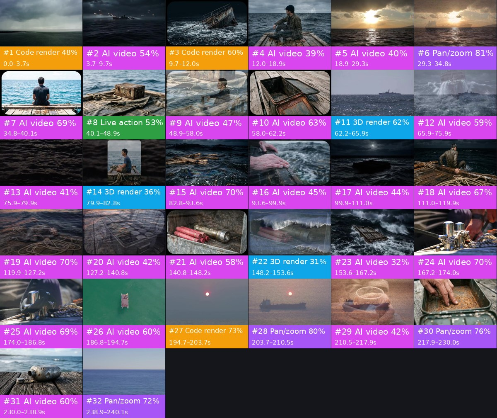
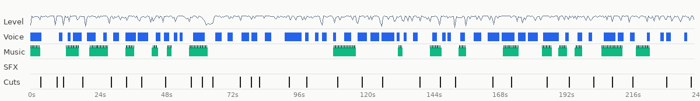

# How this video was made: lawi.mp4

**How it was made**: Mixed production: live action or AI, to confirm 74% + still image + pan/zoom 11% + code / template render 6% + 3D render 5% + live action 4% (39% of the duration is live action or AI, to confirm: the platform transcode erased the noise evidence, needs a VLM pass or a human look at the frames)

- 4:00 · horizontal 16:9 · 32 shots, 7.5s each on average
- Confidence 56%, based on: tool measurements
- ⚠️ **Nobody has looked at the picture yet**: live action / AI / 3D / code render come from pixel statistics only and are often wrong across the board after platform transcoding. Turn on a VLM or have an agent review the shots (`rea-video review`) before remaking from this report
- ⚠️ 31 points are uncertain, see “Open questions”

<!--mix-->



# Part one · Breakdown: how this video is built

## At a glance: picture, packaging, sound

Any short video splits into three layers: the picture, what is laid on top of it (subtitles, styled text, stickers), and the sound. Remake it one layer at a time.

| Layer | In this video | How to make it | Detail |
|---|---|---|---|
| **Picture** (base) | AI-generated video 21 shots, still image + pan/zoom 4 shots, code / template render 3 shots, 3D render 3 shots, live action 1 shot | filmed in 1 scene; AI in 19 generations; screen recording / motion graphics in code; a single image held or moved | “Remake it yourself” |
| **Packaging** (on top) | static sticker, animated sticker / GIF, text, graphic, styled text | add in the editor: subtitles, styled text and stickers by the timeline | “Packaging layer” |
| **Sound** | voice（TTS voice-over） | voice: TTS voice-over | “Sound” |

## Content and structure

- The whole video's content was not analysed this time (needs AI image reading); subtitle text is under “Packaging layer”

- No narrative line this time (what each shot is doing in the story needs AI image reading); the “Picture” column of the shot list is a start

## Shot list

| # | Frame | Time | Picture | Camera | Made with |
|---|---|---|---|---|---|
| 1 |  | 0:00.0 · 3.7s | — | static | code / template render |
| 2 |  | 0:03.7 · 6.0s | — | smooth move | AI-generated video |
| 3 |  | 0:09.7 · 2.3s | — | static | code / template render |
| 4 |  | 0:12.0 · 7.0s | — | smooth move | AI-generated video |
| 5 |  | 0:18.9 · 10.3s | — | smooth move | AI-generated video |
| 6 |  | 0:29.3 · 5.5s | — | whole-frame zoom / pan | still image + pan/zoom |
| 7 |  | 0:34.8 · 5.4s | — | static | AI-generated video |
| 8 |  | 0:40.1 · 8.8s | — | smooth move | live action |
| 9 |  | 0:48.9 · 9.1s | — | static | AI-generated video |
| 10 |  | 0:58.0 · 4.2s | — | static | AI-generated video |
| 11 |  | 1:02.2 · 3.7s | — | smooth move | 3D render |
| 12 |  | 1:05.9 · 10.0s | — | static | AI-generated video |
| 13 |  | 1:15.9 · 4.0s | — | static | AI-generated video |
| 14 |  | 1:19.9 · 2.9s | — | smooth move | 3D render |
| 15 |  | 1:22.8 · 10.8s | — | smooth move | AI-generated video |
| 16 |  | 1:33.6 · 6.3s | — | static | AI-generated video |
| 17 |  | 1:39.9 · 11.2s | — | smooth move | AI-generated video |
| 18 |  | 1:51.0 · 8.9s | — | static (subject moves) | AI-generated video |
| 19 |  | 1:59.9 · 7.3s | — | smooth move | AI-generated video |
| 20 |  | 2:07.2 · 13.6s | — | static | AI-generated video |
| 21 |  | 2:20.8 · 7.4s | — | static | AI-generated video |
| 22 |  | 2:28.2 · 5.5s | — | smooth move | 3D render |
| 23 |  | 2:33.6 · 13.5s | — | smooth move | AI-generated video |
| 24 |  | 2:47.2 · 6.8s | — | static (subject moves) | AI-generated video |
| 25 |  | 2:54.0 · 12.9s | — | smooth move | AI-generated video |
| 26 |  | 3:06.8 · 7.9s | — | whole-frame zoom / pan | AI-generated video |
| 27 |  | 3:14.7 · 9.0s | — | smooth move | code / template render |
| 28 |  | 3:23.7 · 6.8s | — | whole-frame zoom / pan | still image + pan/zoom |
| 29 |  | 3:30.5 · 7.4s | — | smooth move | AI-generated video |
| 30 |  | 3:37.9 · 12.1s | — | whole-frame zoom / pan | still image + pan/zoom |
| 31 |  | 3:50.0 · 8.9s | — | whole-frame zoom / pan | AI-generated video |
| 32 |  | 3:58.9 · 1.2s | — | whole-frame zoom / pan | still image + pan/zoom |

## Cast, scenes and props

- No cast extracted this time (needs AI image reading)

## Camera and lighting

- Framing: shot size medium close-up 100%; subject is the in-focus region (no face; shot size is an estimate)
- Camera: moving camera (gimbal / handheld pan) 100%; typical move push-in
- Lighting: three-quarter key + fill (standard set-up). Key light frame left, three-quarter front, at subject height; lighting ratio about 1.5:1 (0.6 stops); hard light (sharp shadow edge); colour temperature neutral (about 5000K); subject and background differ in colour temperature: mixed sources (e.g. warm lamp + cool window light / screen); background clearly blurred (shallow depth of field / portrait mode)
- Grade: natural (close to the original colours); normal saturation, normal contrast, normal blacks, overall cool

<details class="ref"><summary>Per-item measurements and image readings (5)</summary>

| Aspect | Item | Verdict | Sources |
|---|---|---|---|
| Framing | shot size | medium close-up | measured |
| Camera | camera support | moving camera (gimbal / handheld pan) | measured |
| Lighting | soft / hard | hard light (sharp shadow edge) | measured |
| Lighting | colour temperature | neutral (about 5000K) | measured |
| Grade | colour grade | natural (close to the original colours) | measured |

- Note: lighting ratio, soft / hard, colour temperature and shot size are measured on the subject's pixels (the face when there is one, otherwise the in-focus region, which is an estimate); platform transcodes crush the shadows, so hardness and fill read conservative; camera angle, light source, catchlight and rim light follow the image readers. Where measurement and readers disagree, both are listed.

</details>

## Packaging layer (subtitles / styled text / stickers / sound-effect hits)

- styled text ×2 (large size, multi-colour / gradient, blue fill): "5", "美"
- text label ×7: "一", "133", "A", "2", "心", "一" …
- Stickers / GIFs: static sticker / image ×2, animated sticker / GIF ×1
- 3 persistent layers (unchanged across cuts: lay each on once for its span, not per shot): static sticker / image 3.9–11.9s, static sticker / image 3.9–11.9s, animated sticker / GIF 9.7–18.8s

<details class="ref"><summary>text timeline (9 rows)</summary>

| Time | Kind | Text | Style | In / out | SFX |
|---|---|---|---|---|---|
| 32.14–34.80s | text label | 一 | red text, orange outline, line height 74.9% (about 539px) | hard out | — |
| 37.07–40.14s | text label | 133 | brown text, brown outline, keywords highlighted in blue, line height 35.3% (about 254px) | hard out | — |
| 39.07–40.14s | text label | A | black text, grey outline, keywords highlighted in grey, line height 88.9% (about 640px) | hard out | — |
| 49.07–52.01s | text label | 2 | black text, grey outline, keywords highlighted in orange, line height 38.8% (about 279px) | — | — |
| 67.61–68.68s | text label | 心 | blue text, grey outline, line height 31.5% (about 227px) | fade in / fade out | — |
| 164.02–164.16s | styled text | 5 | grey text, keywords highlighted in grey, line height 24.7% (about 178px) | hard in / hard out | — |
| 176.16–179.09s | styled text | 美 | blue text, blue outline, keywords highlighted in white, line height 45.6% (about 328px) | — | — |
| 204.16–207.09s | text label | 一 | brown text, line height 70.1% (about 505px) | fade in | — |
| 207.09–210.43s | text label | 一 | red text, orange outline, line height 77.0% (about 555px) | fade out | — |

</details>

**Stickers / GIFs / picture-in-picture**

| Time | Kind | Position | Motion | Confidence | Crop |
|---|---|---|---|---|---|
| 3.87–11.87s | static sticker / image | x70% y9% w15% h18% | static | medium (unchanged across a cut) |  |
| 3.87–11.87s | static sticker / image | x75% y36% w10% h18% | static | medium (unchanged across a cut) |  |
| 9.73–18.80s | animated sticker / GIF | x15% y55% w15% h18% | animated | medium (unchanged across a cut) |  |

- Remake: import `packaging/subtitles.srt` into your editor and put in your own words; the styled version is `packaging/overlays.ass`; find matching stickers and GIFs in an asset library

## Sound

**Voice**

- male-leaning
- Source: TTS voice-over
- Remake: TTS voice-over: CapCut text-to-speech or another TTS tool, with a similar voice and pace

**Listen to the tracks**

<!--stems-->

<details class="ref"><summary>Sound measurements and evidence</summary>



- Loudness -19.3 dBFS, peak -6.3 dBFS
- sound runs across cuts, laid in post as one bed (background changes 9.7dB at cuts vs 8.1dB within shots)
- Voice on 46% of the duration, pitch about 107.8Hz
- Voice source: TTS voice-over (TTS voice-over 64%, human recording 27%, native dialogue from the AI video model 9%)
  - Voice and background sound run across cuts: the voice-over was laid on separately in post (TTS or a human voice-over)

</details>

## Open questions

- The VLM did not run (No VLM; live action / AI / 3D are told apart from pixel statistics only, so confidence is limited. An agent that can see images: run rea-video review, look at each shot and merge with apply-review; otherwise configure a VLM (any OpenAI-compatible multimodal model, e.g. Gemini / GPT-4o / Doubao / Qwen-VL): set REA_VLM_BASE_URL, REA_VLM_API_KEY and REA_VLM_MODEL (several models comma-separated as fallbacks), then rerun with --vlm): live action / AI / 3D is decided by signal forensics alone; configure a multimodal model and rerun with --vlm, or have an agent review the frames
- Shot #1 (0.0–3.7s): code / template render at only 48% confidence, runner-up ai_video
- Shot #2 (3.7–9.7s): AI, 24p camera footage or film / TV footage, to confirm: only frame-rate evidence (a 24fps source, which films and TV share) and no AIGC label, needs an image reader
- Shot #3 (9.7–12.0s): code / template render at only 60% confidence, runner-up cg_3d
- Shot #4 (12.0–18.9s): Live action / stop motion or AI, to confirm: no AIGC label; 24fps-source marks appear in AI video, stop motion and cinema-camera footage alike
- Shot #5 (18.9–29.3s): Live action / stop motion or AI, to confirm: no AIGC label; 24fps-source marks appear in AI video, stop motion and cinema-camera footage alike
- Shot #6 (29.3–34.8s): photo / image: real material or generated, to confirm
- Shot #7 (34.8–40.1s): AI, 24p camera footage or film / TV footage, to confirm: only frame-rate evidence (a 24fps source, which films and TV share) and no AIGC label, needs an image reader
- Shot #8 (40.1–48.9s): live action at only 53% confidence, runner-up ai_video
- Shot #9 (48.9–58.0s): Live action / stop motion or AI, to confirm: no AIGC label; 24fps-source marks appear in AI video, stop motion and cinema-camera footage alike
- Shot #10 (58.0–62.2s): AI, 24p camera footage or film / TV footage, to confirm: only frame-rate evidence (a 24fps source, which films and TV share) and no AIGC label, needs an image reader
- Shot #12 (65.9–75.9s): AI, 24p camera footage or film / TV footage, to confirm: only frame-rate evidence (a 24fps source, which films and TV share) and no AIGC label, needs an image reader
- Shot #13 (75.9–79.9s): Live action / stop motion or AI, to confirm: no AIGC label; 24fps-source marks appear in AI video, stop motion and cinema-camera footage alike
- Shot #14 (79.9–82.8s): 3D render at only 36% confidence, runner-up ai_video
- Shot #15 (82.8–93.6s): AI, 24p camera footage or film / TV footage, to confirm: only frame-rate evidence (a 24fps source, which films and TV share) and no AIGC label, needs an image reader
- Shot #16 (93.6–99.9s): Live action / stop motion or AI, to confirm: no AIGC label; 24fps-source marks appear in AI video, stop motion and cinema-camera footage alike
- Shot #17 (99.9–111.0s): AI, 24p camera footage or film / TV footage, to confirm: only frame-rate evidence (a 24fps source, which films and TV share) and no AIGC label, needs an image reader
- Shot #18 (111.0–119.9s): AI, 24p camera footage or film / TV footage, to confirm: only frame-rate evidence (a 24fps source, which films and TV share) and no AIGC label, needs an image reader
- Shot #19 (119.9–127.2s): AI, 24p camera footage or film / TV footage, to confirm: only frame-rate evidence (a 24fps source, which films and TV share) and no AIGC label, needs an image reader
- Shot #20 (127.2–140.8s): AI or live action, to confirm: no 24fps-source duplicate frames and no AIGC / generator label, so the AI call rests on a clean picture with little sensor noise; live footage downloaded from a platform or re-compressed looks the same, needs an image reader
- Shot #21 (140.8–148.2s): AI or live action, to confirm: no 24fps-source duplicate frames and no AIGC / generator label, so the AI call rests on a clean picture with little sensor noise; live footage downloaded from a platform or re-compressed looks the same, needs an image reader
- Shot #22 (148.2–153.6s): 3D render at only 31% confidence, runner-up ai_video
- Shot #23 (153.6–167.2s): Live action / stop motion or AI, to confirm: no AIGC label; 24fps-source marks appear in AI video, stop motion and cinema-camera footage alike
- Shot #24 (167.2–174.0s): AI, 24p camera footage or film / TV footage, to confirm: only frame-rate evidence (a 24fps source, which films and TV share) and no AIGC label, needs an image reader
- Shot #25 (174.0–186.8s): AI, 24p camera footage or film / TV footage, to confirm: only frame-rate evidence (a 24fps source, which films and TV share) and no AIGC label, needs an image reader
- Shot #26 (186.8–194.7s): AI, 24p camera footage or film / TV footage, to confirm: only frame-rate evidence (a 24fps source, which films and TV share) and no AIGC label, needs an image reader
- Shot #28 (203.7–210.5s): photo / image: real material or generated, to confirm
- Shot #29 (210.5–217.9s): Live action / stop motion or AI, to confirm: no AIGC label; 24fps-source marks appear in AI video, stop motion and cinema-camera footage alike
- Shot #30 (217.9–230.0s): photo / image: real material or generated, to confirm
- Shot #31 (230.0–238.9s): AI, 24p camera footage or film / TV footage, to confirm: only frame-rate evidence (a 24fps source, which films and TV share) and no AIGC label, needs an image reader
- No AI listened to the soundtrack: real voice versus TTS is inferred from the waveform; the effects were found on the separated effects track and their types are estimated from the sound. Play the stems and each effect under “Sound” to check

# Part two · Remake plan

Planned for **MiniMax H3 / H3 Max**: ≤15 s per call, several shots per call, takes reference video (3 clips, ≤15 s in all), ≤9 reference images, first / last frame, native sound. Name another model and the split, lengths and prompts are redone for it.

## Remake it yourself: do it in this order

Copy the method and the rhythm, not the pictures: keep what each part does and fill it with your own content and material.

This is a AI story short. Do the steps in this order; the detail for each is in the matching subsection below.

1. **Write the content**: one picture of your own for each of the 32 shots in the shot list
2. **Collect material**: the real material in the picture (live footage) needs the original files, listed under “What to prepare”
3. **Fill in the prompts**: this run had no image reading, so the shot descriptions in the units are empty; have the agent read the shots first
4. **Generate**: 19 calls (191 s), several shots each. Each shot gets one source frame for composition (subtitles erased, in `remake/refs/`), the swapped-in people, animals and products get reference images, and the prompt lists the shots in order
5. **Adapt the prompts to your model**: the prompts in this report are generic, and every model reads them differently (how shots are split, how references are addressed, how dialogue is written). Before generating, rewrite them following the official prompt guide of the model you actually use, or have the agent refine them with that model's prompting skill; notes for MiniMax H3 / H3 Max at the top of “AI generation”
6. **Live shots**: 1 shots to film yourself; camera and light under “Shoot” below
7. **Motion graphics**: have the agent make an editable first version and change the text and pictures on top of it rather than starting from scratch; the first version is only a start, where it differs from the original is under “Code build”
8. **Stills with moves**: swap in your images; the agent moves them the way the original does
9. **Voice**: the original is TTS voice-over; record it yourself or use TTS
10. **Edit**: follow the order and lengths in the shot list; the original has 32 shots at 7.5s each; 11 transitions under “Edit”
11. **Subtitles and styled text**: timing and style under “Packaging layer”
12. **Put it together and compare**: hand the shots you made to the agent; it places them on the original timeline, keeps the original where yours are missing, and renders a side-by-side comparison with the original

### Shoot

Shoot every shot of one scene before moving to the next; within a scene, shoot the wider sizes first and the close-ups last so the lighting is set only once. Leave about 1s of handle at both ends of every take.

**S1**: shots #8 (8.77s on screen)
- Lighting: three-quarter key + fill (standard set-up), key light frame left, three-quarter front, neutral (about 5000K)
- Setup medium close-up · moving camera (gimbal / handheld pan) · push-in: shots #8, 8.77s on screen, shoot about 10.8s

Gear (inferred from the measured light):
- key: LED + softbox from 45° high on one side of the desk
- white card / bounce board as fill on the other side
- optional: a rim light from behind for edge

### AI generation

**19 generations, 191 s in total**

> ⚠️ G1、G2、G3、G4、G5、G6、G7、G8、G9、G10、G11、G12、G13、G14、G15、G16、G17、G18、G19: the prompts are still generic drafts. Rewrite them in MiniMax H3 / H3 Max's official format (or have the agent write them with that model's prompting skill) into `remake/prompts.json`, numbering images in the unit's reference order; `rea-video plan` then checks the format.

| Part | Shots | Time | Length | Prepare |
|---|---|---|---|---|
| G1 | #2, #4 | 3.7–9.7s, 12.0–18.9s | 12.9s | reference images |
| G2 | #5 | 18.9–29.3s | 10.3s | reference images |
| G3 | #7 | 34.8–40.1s | 5.4s | reference images |
| G4 | #9, #10 | 48.9–62.2s | 13.3s | reference images |
| G5 | #11, #12 | 62.2–75.9s | 13.7s | reference images |
| G6 | #13, #14 | 75.9–82.8s | 6.9s | reference images |
| G7 | #15 | 82.8–93.6s | 10.8s | reference images |
| G8 | #16 | 93.6–99.9s | 6.3s | reference images |
| G9 | #17 | 99.9–111.0s | 11.2s | reference images |
| G10 | #18 | 111.0–119.9s | 8.9s | reference images |
| G11 | #19 | 119.9–127.2s | 7.3s | reference images |
| G12 | #20 | 127.2–140.8s | 13.6s | reference images |
| G13 | #21, #22 | 140.8–153.6s | 12.8s | reference images |
| G14 | #23 | 153.6–167.2s | 13.5s | reference images |
| G15 | #24 | 167.2–174.0s | 6.8s | reference images |
| G16 | #25 | 174.0–186.8s | 12.9s | reference images |
| G17 | #26 | 186.8–194.7s | 7.9s | reference images |
| G18 | #29 | 210.5–217.9s | 7.4s | reference images |
| G19 | #31 | 230.0–238.9s | 8.9s | reference images |

<details class="ref"><summary>Why it is split this way</summary>

- Grouping: consecutive shots share a call where they fit, ≤15s per call, ≤4 shots; a long stretch is cut at a scene change first
- Inputs: the model takes no reference video: one source frame per shot (subtitles erased) fixes composition, swapped-in things get their own images
- Audio: the model can generate action sound effects and ambience along with the picture; voice-over is better done as separate TTS and mixed in, so copy and timing stay editable
- Packaging: the sticker, text label, styled text on the generated shots is post-production packaging: keep it out of the prompts (erased from source references) and lay it back on from the packaging timeline after generation

</details>

<details><summary>G1 · shots #2, #4 · 12.9s</summary>

- reference images: source frames of shots #2、#4 (subtitles erased)

- these shots are separated by inserts in the cut: generate them together and put the inserts back in the edit

Draft prompt (generic; rewrite it in MiniMax H3 / H3 Max's format into remake/prompts.json before generating):

```text
Generate the shots below in order in one go, hard cuts between them; each shot takes composition, size and camera from its source frame image. Horizontal 16:9; soft frontal light (flat light), hard light (sharp shadow edge), cool (daylight / cool-white LED), background clearly blurred (shallow depth of field / portrait mode). No subtitles, captions or watermarks in the picture.
Shot 1 (from 0.0s): (no description: write one in the image review) (composition: @图片1)
Shot 2 (from 6.0s): (no description: write one in the image review) (composition: @图片2)
```

</details>

<details><summary>G2 · shots #5 · 10.3s</summary>

- reference images: source frames of shots #5 (subtitles erased)

Draft prompt (generic; rewrite it in MiniMax H3 / H3 Max's format into remake/prompts.json before generating):

```text
Generate the shots below in order in one go, hard cuts between them; each shot takes composition, size and camera from its source frame image. Horizontal 16:9; soft frontal light (flat light), hard light (sharp shadow edge), cool (daylight / cool-white LED), background clearly blurred (shallow depth of field / portrait mode). No subtitles, captions or watermarks in the picture.
(no description: write one in the image review) (composition: @图片1)
```

</details>

<details><summary>G3 · shots #7 · 5.4s</summary>

- reference images: source frames of shots #7 (subtitles erased)

Draft prompt (generic; rewrite it in MiniMax H3 / H3 Max's format into remake/prompts.json before generating):

```text
Generate the shots below in order in one go, hard cuts between them; each shot takes composition, size and camera from its source frame image. Horizontal 16:9; soft frontal light (flat light), hard light (sharp shadow edge), cool (daylight / cool-white LED), background clearly blurred (shallow depth of field / portrait mode). No subtitles, captions or watermarks in the picture.
(no description: write one in the image review) (composition: @图片1)
```

</details>

<details><summary>G4 · shots #9, #10 · 13.3s</summary>

- reference images: source frames of shots #9、#10 (subtitles erased)

Draft prompt (generic; rewrite it in MiniMax H3 / H3 Max's format into remake/prompts.json before generating):

```text
Generate the shots below in order in one go, hard cuts between them; each shot takes composition, size and camera from its source frame image. Horizontal 16:9; soft frontal light (flat light), hard light (sharp shadow edge), cool (daylight / cool-white LED), background clearly blurred (shallow depth of field / portrait mode). No subtitles, captions or watermarks in the picture.
Shot 1 (from 0.0s): (no description: write one in the image review) (composition: @图片1)
Shot 2 (from 9.1s): (no description: write one in the image review) (composition: @图片2)
```

</details>

<details><summary>G5 · shots #11, #12 · 13.7s</summary>

- reference images: source frames of shots #11、#12 (subtitles erased)

Draft prompt (generic; rewrite it in MiniMax H3 / H3 Max's format into remake/prompts.json before generating):

```text
Generate the shots below in order in one go, hard cuts between them; each shot takes composition, size and camera from its source frame image. Horizontal 16:9; soft frontal light (flat light), hard light (sharp shadow edge), cool (daylight / cool-white LED), background clearly blurred (shallow depth of field / portrait mode). No subtitles, captions or watermarks in the picture.
Shot 1 (from 0.0s): (no description: write one in the image review) (composition: @图片1)
Shot 2 (from 3.7s): (no description: write one in the image review) (composition: @图片2)
```

</details>

<details><summary>G6 · shots #13, #14 · 6.9s</summary>

- reference images: source frames of shots #13、#14 (subtitles erased)

Draft prompt (generic; rewrite it in MiniMax H3 / H3 Max's format into remake/prompts.json before generating):

```text
Generate the shots below in order in one go, hard cuts between them; each shot takes composition, size and camera from its source frame image. Horizontal 16:9; soft frontal light (flat light), hard light (sharp shadow edge), cool (daylight / cool-white LED), background clearly blurred (shallow depth of field / portrait mode). No subtitles, captions or watermarks in the picture.
Shot 1 (from 0.0s): (no description: write one in the image review) (composition: @图片1)
Shot 2 (from 4.0s): (no description: write one in the image review) (composition: @图片2)
```

</details>

<details><summary>G7 · shots #15 · 10.8s</summary>

- reference images: source frames of shots #15 (subtitles erased)

Draft prompt (generic; rewrite it in MiniMax H3 / H3 Max's format into remake/prompts.json before generating):

```text
Generate the shots below in order in one go, hard cuts between them; each shot takes composition, size and camera from its source frame image. Horizontal 16:9; soft frontal light (flat light), hard light (sharp shadow edge), cool (daylight / cool-white LED), background clearly blurred (shallow depth of field / portrait mode). No subtitles, captions or watermarks in the picture.
(no description: write one in the image review) (composition: @图片1)
```

</details>

<details><summary>G8 · shots #16 · 6.3s</summary>

- reference images: source frames of shots #16 (subtitles erased)

Draft prompt (generic; rewrite it in MiniMax H3 / H3 Max's format into remake/prompts.json before generating):

```text
Generate the shots below in order in one go, hard cuts between them; each shot takes composition, size and camera from its source frame image. Horizontal 16:9; soft frontal light (flat light), hard light (sharp shadow edge), cool (daylight / cool-white LED), background clearly blurred (shallow depth of field / portrait mode). No subtitles, captions or watermarks in the picture.
(no description: write one in the image review) (composition: @图片1)
```

</details>

<details><summary>G9 · shots #17 · 11.2s</summary>

- reference images: source frames of shots #17 (subtitles erased)

Draft prompt (generic; rewrite it in MiniMax H3 / H3 Max's format into remake/prompts.json before generating):

```text
Generate the shots below in order in one go, hard cuts between them; each shot takes composition, size and camera from its source frame image. Horizontal 16:9; soft frontal light (flat light), hard light (sharp shadow edge), cool (daylight / cool-white LED), background clearly blurred (shallow depth of field / portrait mode). No subtitles, captions or watermarks in the picture.
(no description: write one in the image review) (composition: @图片1)
```

</details>

<details><summary>G10 · shots #18 · 8.9s</summary>

- reference images: source frames of shots #18 (subtitles erased)

Draft prompt (generic; rewrite it in MiniMax H3 / H3 Max's format into remake/prompts.json before generating):

```text
Generate the shots below in order in one go, hard cuts between them; each shot takes composition, size and camera from its source frame image. Horizontal 16:9; soft frontal light (flat light), hard light (sharp shadow edge), cool (daylight / cool-white LED), background clearly blurred (shallow depth of field / portrait mode). No subtitles, captions or watermarks in the picture.
(no description: write one in the image review) (composition: @图片1)
```

</details>

<details><summary>G11 · shots #19 · 7.3s</summary>

- reference images: source frames of shots #19 (subtitles erased)

Draft prompt (generic; rewrite it in MiniMax H3 / H3 Max's format into remake/prompts.json before generating):

```text
Generate the shots below in order in one go, hard cuts between them; each shot takes composition, size and camera from its source frame image. Horizontal 16:9; soft frontal light (flat light), hard light (sharp shadow edge), cool (daylight / cool-white LED), background clearly blurred (shallow depth of field / portrait mode). No subtitles, captions or watermarks in the picture.
(no description: write one in the image review) (composition: @图片1)
```

</details>

<details><summary>G12 · shots #20 · 13.6s</summary>

- reference images: source frames of shots #20 (subtitles erased)

Draft prompt (generic; rewrite it in MiniMax H3 / H3 Max's format into remake/prompts.json before generating):

```text
Generate the shots below in order in one go, hard cuts between them; each shot takes composition, size and camera from its source frame image. Horizontal 16:9; soft frontal light (flat light), hard light (sharp shadow edge), cool (daylight / cool-white LED), background clearly blurred (shallow depth of field / portrait mode). No subtitles, captions or watermarks in the picture.
(no description: write one in the image review) (composition: @图片1)
```

</details>

<details><summary>G13 · shots #21, #22 · 12.8s</summary>

- reference images: source frames of shots #21、#22 (subtitles erased)

Draft prompt (generic; rewrite it in MiniMax H3 / H3 Max's format into remake/prompts.json before generating):

```text
Generate the shots below in order in one go, hard cuts between them; each shot takes composition, size and camera from its source frame image. Horizontal 16:9; soft frontal light (flat light), hard light (sharp shadow edge), cool (daylight / cool-white LED), background clearly blurred (shallow depth of field / portrait mode). No subtitles, captions or watermarks in the picture.
Shot 1 (from 0.0s): (no description: write one in the image review) (composition: @图片1)
Shot 2 (from 7.4s): (no description: write one in the image review) (composition: @图片2)
```

</details>

<details><summary>G14 · shots #23 · 13.5s</summary>

- reference images: source frames of shots #23 (subtitles erased)

Draft prompt (generic; rewrite it in MiniMax H3 / H3 Max's format into remake/prompts.json before generating):

```text
Generate the shots below in order in one go, hard cuts between them; each shot takes composition, size and camera from its source frame image. Horizontal 16:9; soft frontal light (flat light), hard light (sharp shadow edge), cool (daylight / cool-white LED), background clearly blurred (shallow depth of field / portrait mode). No subtitles, captions or watermarks in the picture.
(no description: write one in the image review) (composition: @图片1)
```

</details>

<details><summary>G15 · shots #24 · 6.8s</summary>

- reference images: source frames of shots #24 (subtitles erased)

Draft prompt (generic; rewrite it in MiniMax H3 / H3 Max's format into remake/prompts.json before generating):

```text
Generate the shots below in order in one go, hard cuts between them; each shot takes composition, size and camera from its source frame image. Horizontal 16:9; soft frontal light (flat light), hard light (sharp shadow edge), cool (daylight / cool-white LED), background clearly blurred (shallow depth of field / portrait mode). No subtitles, captions or watermarks in the picture.
(no description: write one in the image review) (composition: @图片1)
```

</details>

<details><summary>G16 · shots #25 · 12.9s</summary>

- reference images: source frames of shots #25 (subtitles erased)

Draft prompt (generic; rewrite it in MiniMax H3 / H3 Max's format into remake/prompts.json before generating):

```text
Generate the shots below in order in one go, hard cuts between them; each shot takes composition, size and camera from its source frame image. Horizontal 16:9; soft frontal light (flat light), hard light (sharp shadow edge), cool (daylight / cool-white LED), background clearly blurred (shallow depth of field / portrait mode). No subtitles, captions or watermarks in the picture.
(no description: write one in the image review) (composition: @图片1)
```

</details>

<details><summary>G17 · shots #26 · 7.9s</summary>

- reference images: source frames of shots #26 (subtitles erased)

Draft prompt (generic; rewrite it in MiniMax H3 / H3 Max's format into remake/prompts.json before generating):

```text
Generate the shots below in order in one go, hard cuts between them; each shot takes composition, size and camera from its source frame image. Horizontal 16:9; soft frontal light (flat light), hard light (sharp shadow edge), cool (daylight / cool-white LED), background clearly blurred (shallow depth of field / portrait mode). No subtitles, captions or watermarks in the picture.
(no description: write one in the image review) (composition: @图片1)
```

</details>

<details><summary>G18 · shots #29 · 7.4s</summary>

- reference images: source frames of shots #29 (subtitles erased)

Draft prompt (generic; rewrite it in MiniMax H3 / H3 Max's format into remake/prompts.json before generating):

```text
Generate the shots below in order in one go, hard cuts between them; each shot takes composition, size and camera from its source frame image. Horizontal 16:9; soft frontal light (flat light), hard light (sharp shadow edge), cool (daylight / cool-white LED), background clearly blurred (shallow depth of field / portrait mode). No subtitles, captions or watermarks in the picture.
(no description: write one in the image review) (composition: @图片1)
```

</details>

<details><summary>G19 · shots #31 · 8.9s</summary>

- reference images: source frames of shots #31 (subtitles erased)

Draft prompt (generic; rewrite it in MiniMax H3 / H3 Max's format into remake/prompts.json before generating):

```text
Generate the shots below in order in one go, hard cuts between them; each shot takes composition, size and camera from its source frame image. Horizontal 16:9; soft frontal light (flat light), hard light (sharp shadow edge), cool (daylight / cool-white LED), background clearly blurred (shallow depth of field / portrait mode). No subtitles, captions or watermarks in the picture.
(no description: write one in the image review) (composition: @图片1)
```

</details>

### Code build

Rebuild it as one project in an HTML video framework (such as HyperFrames or Remotion): cuts, transitions and each shot's key frames from "Rhythm and key frames", layout, colours and elements from the scenes below. Text and UI are 100% controllable, changing copy is a data change, and an AI coding assistant can write the project.

`rea-video code-remake <breakdown folder>` only makes a quick draft: it renders `code/remake.mp4` from each scene's sampled points / cut-out, motion and background glow and scores it. Particles, point clouds and data visualisations on a dark ground come close; an illustrated character's acting and morph transitions do not.

- Part 1: shots #1 (0.0–3.7s)
- Part 2: shots #3 (9.7–12.0s)
- Part 3: shots #27 (194.7–203.7s)

Remake assets (all in the report folder; hand them over together with the data below to whoever writes the code, or to an LLM):
- `shots/shot_XXX_first.jpg` / `_last.jpg`: first / last frame of each shot at full size, for layout, type size and margins
- `shots/shot_XXX_strip.jpg`: key frames about every 0.5 s, to follow the animation
- `shots/shot_XXX_elements.jpg` and `_el_NN.jpg` / `_st_NN.jpg` / `_ly_NN.jpg`: full-size crop of every element once settled, numbered as in the motion timeline; redraw shapes from them, cut out icons, logos and illustrations that cannot be redrawn
- `packaging/overlays.ass`, `packaging/timeline.json`: timing, position and colour of the text

How to build the pictures (by the measured picture type):
- kinetic type: Word-by-word spring() entrances (offset + scale + opacity), highlight boxes on key words; match font, size and leading from the frame
- particles / point cloud: Three.js particle system (points sampled on the target shape, morph between shapes, bloom), rendered frame by frame with @remotion/three
- vector shapes: SVG shapes + interpolate() / spring() keyframes, positions and timing measured from the frame

Particle shots: what shape the particles form in each shot and how it moves decides whether the remake works; chapter cards, labels and counters go in an HTML layer on top. Build shot by shot from the table below, not one shared background.

| Shot | Time | Build | Picture | Camera | Colours | On-screen text |
|---|---|---|---|---|---|---|
| #1 | 0.0–3.7s | kinetic type | (to fill from the images: what the elements form and how they move) | static | ground #0b1618 · #808e96 #99a3a6 #51606e #1e2928 · drawn #9ca19e #b9bdba #293433 #05080b | 1942 |
| #3 | 9.7–12.0s | particles / point cloud | (to fill from the images: what the elements form and how they move) | static | ground #000204 · #021219 #29323a #19222a #3d474e #515e67 · drawn #69757d #88959f #4a5056 #aebbc5 | — |
| #27 | 194.7–203.7s | vector shapes | (to fill from the images: what the elements form and how they move) | static frame, elements move inside it | ground #5f666d · #666e7d #606b78 #757481 #586775 · drawn #fefaf7 #d6ada7 #c1807f #f5ddce | — |

**Picture scenes** (a new scene whenever what is drawn moves or changes shape as a whole inside a shot. `frames/` holds first / middle / last full-size frames per scene, `scene_XX_layer.png` the drawn layer of the middle frame (background and text removed, alpha by how strongly it stands out), `frames/points/scene_XX.json` samples of that layer, one `x y r g b a` per row with x, y in 0–1. Place particles, trace lines or redraw shapes from these instead of guessing from a description. `track` in `frames/scenes.json` follows the layer's centre and spread over time)

| Scene | Shot | Time | Ground | Background glow | Drawn colours | Pieces | Area (x0 y0 x1 y1) | Motion |
|---|---|---|---|---|---|---|---|---|
| scene_01 | #1 | 0.0–3.7s | #56647a | #081112, centre (0.58, 0.60), radius 0.29 | #a7aeaa #2a3733 #05090a | 30 | 0.03 0.56 0.99 0.74 | near still |
| scene_02 | #3 | 9.7–12.0s | #000000 | #657279, centre (0.55, 0.67), radius 0.24 | #808e95 #56636a #adbbc2 | 548 | 0.04 0.48 0.96 0.95 | near still |
| scene_03 | #27 | 194.7–203.7s | #686e79 | #8c7885, centre (0.51, 0.12), radius 0.19 | #fdfdf9 #f4e4d3 #c3918d | 1 | 0.48 0.29 0.52 0.36 | near still |

When built, score it with `rea-video compare original remake --scenes frames/scenes.json -o dir` (each side's drawn layer is taken against its own ground, so a new ground colour still compares) and fix the lowest-scoring scenes first, from `compare_worst.jpg`.

Per-shot motion timeline (measured: positions in % of frame width / height, colours sampled once the element settles; read together with the key-frame strip)

<details class="ref"><summary>Motion #1 0.0–3.7s · 0 events</summary>


- Ground #0b1618; other main colours #808e96 #99a3a6 #51606e #1e2928; drawn layer #9ca19e #b9bdba #293433 #05080b
Element crops (numbers match the motion list below; L = the continuously moving layer mid-shot and at the end, S = elements that never move), full-size files in `shots/`:


- S1. never moves: shape / text block · x 0%–67%, y 72%–100% · #060b0f · [crop](shots/shot_001_st_01.jpg)

</details>

<details class="ref"><summary>Motion #3 9.7–12.0s · 2 events</summary>


- Ground #000204; other main colours #021219 #29323a #19222a #3d474e #515e67; drawn layer #69757d #88959f #4a5056 #aebbc5
Element crops (numbers match the motion list below; L = the continuously moving layer mid-shot and at the end, S = elements that never move), full-size files in `shots/`:


- [crop L1](shots/shot_003_ly_01.jpg) [crop L2](shots/shot_003_ly_02.jpg) · Continuous layer: 52% of the frame moves through the whole shot (x 2%–98%, y 8%–96%), e.g. drifting gradients, particle flow, breathing glow
1. 11.67–11.93s · middle right (x 58%–82%, y 44%–64%) · changes, ease-in-out · #50575d · [crop](shots/shot_003_el_01.jpg)
2. 11.67–11.93s · bottom left (x 2%–27%, y 76%–96%) · changes, moves leftward, ease-in-out · #333a43 · [crop](shots/shot_003_el_02.jpg)

</details>

<details class="ref"><summary>Motion #27 194.7–203.7s · 0 events</summary>


- Ground #5f666d; other main colours #666e7d #606b78 #757481 #586775; drawn layer #fefaf7 #d6ada7 #c1807f #f5ddce
Element crops (numbers match the motion list below; L = the continuously moving layer mid-shot and at the end, S = elements that never move), full-size files in `shots/`:


- S1. never moves: shape / text block · x 13%–69%, y 52%–72% · #5a6171 · [crop](shots/shot_027_st_01.jpg)
- S2. never moves: shape / text block · x 81%–87%, y 91%–99% · #636062 · [crop](shots/shot_027_st_02.jpg)

</details>

### Local rebuild

- #6 still image + pan/zoom 5.5s; #28 still image + pan/zoom 6.8s; #30 still image + pan/zoom 12.1s; #32 still image + pan/zoom 1.2s: one image + the measured zoom / pan parameters, rendered straight from ffmpeg

### Edit

- Cut in the order and lengths of the shot list
- Rhythm: 7.7 cuts per minute, 8.77s average live-action shot; 1 camera set-up(s) / location(s); 0 jump cut(s) and 0 punch-in(s) within the same set-up; inserts (screenshots / screen recordings / cards / stock) take 96%; transitions cut×20, dissolve×9, jump cut×1, wipe×1

**Transitions**

| Time | Into shot | Transition |
|---|---|---|
| 48.5–49.2s | #9 | dissolve, 0.7s |
| 65.8–66.1s | #12 | dissolve, 0.3s |
| 75.9–76.4s | #13 | wipe, upwards, 0.5s |
| 79.8–80.8s | #14 | dissolve, 1.1s |
| 93.4–93.8s | #16 | dissolve, 0.4s |
| 119.7–120.1s | #19 | dissolve, 0.4s |
| 127.0–127.4s | #20 | dissolve, 0.4s |
| 147.9–148.3s | #22 | dissolve, 0.4s |
| 203.6–203.9s | #28 | dissolve, 0.3s |
| 210.4–210.8s | #29 | dissolve, 0.4s |

## Appendix

### Shot by shot

Each shot has two parts: what is visible on screen, and how the tools infer it was made (with the basis); remake prompts last. Folded by default.

<details class="ref"><summary>#1 00:00.000–00:03.700 · code / template render</summary>


**Visible on screen** (check against the frames)
- Text track (text in the picture/middle): 1942

**How it was made, as inferred by the tools** (inferred, not seen)
- Inference: code / template render 48%, AI-generated video 20%, static hold 13% (deterministic)
- Material: rendered by the creator
- Basis (tool measurements, not necessarily visible to the eye):
  - 85% of adjacent frames are exact duplicates, only local elements move (typical of template / motion-graphics animation, or a hold with local motion)
  - Platform transcode (YouTube) has compressed the sensor noise away: noise cues no longer apply, live action vs AI rests on frame rate and picture content

- Remake: Code render: rebuild in an HTML video framework (such as HyperFrames or Remotion) from the rhythm, key frames and layout, 100% controllable, no generative model needed

</details>

<details class="ref"><summary>#2 00:03.700–00:09.667 · AI-generated video + code / editor overlays (static sticker)</summary>


**Visible on screen** (check against the frames)
- Camera / lighting: medium close-up; moving camera (gimbal / handheld pan); night / low-light ambient, no dedicated fill; key light frame left, three-quarter front; lighting ratio about 1.6:1 (0.7 stops); hard light (sharp shadow edge)

**How it was made, as inferred by the tools** (inferred, not seen)
- Inference: AI-generated video 54%, 3D render 32%, code / template render 7% (deterministic)
- ⚠️ To confirm: AI, 24p camera footage or film / TV footage, to confirm: only frame-rate evidence (a 24fps source, which films and TV share) and no AIGC label, needs an image reader
- Material: AI-generated
- Basis (tool measurements, not necessarily visible to the eye):
  - Duplicate frames follow a 25→30? pattern (7%, period 6): a 24/25fps source transcoded up, typical of AI-generated video, 3D / animation renders or cinema footage

- Remake: Source is AI-generated: remake it with a video model; which shots share a call and what it is fed (the source clip, keyframes or first / last frames) depend on the chosen model, see the generation units in the remake plan

</details>

<details class="ref"><summary>#3 00:09.667–00:11.967 · code / template render + code / editor overlays (static sticker, animated sticker / GIF)</summary>


**Visible on screen** (check against the frames)
- Text track (text in the picture/middle): Zelukan

**How it was made, as inferred by the tools** (inferred, not seen)
- Inference: code / template render 60%, 3D render 20%, live action 8% (deterministic)
- Material: rendered by the creator
- Basis (tool measurements, not necessarily visible to the eye):
  - On a dark ground the lit part is almost all fine dots / thin lines (with the smooth background taken out, only 6% of lit pixels shade gently, 12 bright peaks per 100 lit pixels): particle / point-cloud / wireframe graphics, not a shaded photo, 3D surface or AI picture
  - Rendered texture: 23% flat colour blocks, 95% of pixels use only 39 colours, 12% axis-aligned edges

- Remake: Code render: rebuild in an HTML video framework (such as HyperFrames or Remotion) from the rhythm, key frames and layout, 100% controllable, no generative model needed

</details>

<details class="ref"><summary>#4 00:11.967–00:18.933 · AI-generated video + code / editor overlays (animated sticker / GIF)</summary>


**Visible on screen** (check against the frames)
- Camera / lighting: medium close-up; moving camera (gimbal / handheld pan); backlit / background brighter than subject; key light frontal (from the camera side; both sides of the subject about equally bright); lighting ratio about 1.2:1 (0.3 stops); soft light (wide lit-to-shadow ramp)
- Motion beats within the shot: 12.53s

**How it was made, as inferred by the tools** (inferred, not seen)
- Inference: AI-generated video 39%, live action 32%, 3D render 17% (deterministic)
- ⚠️ To confirm: Live action / stop motion or AI, to confirm: no AIGC label; 24fps-source marks appear in AI video, stop motion and cinema-camera footage alike
- Material: AI-generated
- Basis (tool measurements, not necessarily visible to the eye):
  - Photographic texture: noise σ=0.59, 73 colours, 1% flat blocks
  - Platform transcode (YouTube) has compressed the sensor noise away: noise cues no longer apply, live action vs AI rests on frame rate and picture content

- Remake: Source is AI-generated: remake it with a video model; which shots share a call and what it is fed (the source clip, keyframes or first / last frames) depend on the chosen model, see the generation units in the remake plan

</details>

<details class="ref"><summary>#5 00:18.933–00:29.267 · AI-generated video</summary>


**Visible on screen** (check against the frames)
- Camera / lighting: medium close-up; moving camera (gimbal / handheld pan); backlit / background brighter than subject; key light frame right, three-quarter front; lighting ratio about 1.6:1 (0.7 stops); hard light (sharp shadow edge)

**How it was made, as inferred by the tools** (inferred, not seen)
- Inference: AI-generated video 40%, live action 33%, 3D render 15% (deterministic)
- ⚠️ To confirm: Live action / stop motion or AI, to confirm: no AIGC label; 24fps-source marks appear in AI video, stop motion and cinema-camera footage alike
- Material: AI-generated
- Basis (tool measurements, not necessarily visible to the eye):
  - Photographic texture: noise σ=0.38, 86 colours, 3% flat blocks
  - Platform transcode (YouTube) has compressed the sensor noise away: noise cues no longer apply, live action vs AI rests on frame rate and picture content

- Remake: Source is AI-generated: remake it with a video model; which shots share a call and what it is fed (the source clip, keyframes or first / last frames) depend on the chosen model, see the generation units in the remake plan

</details>

<details class="ref"><summary>#6 00:29.267–00:34.767 · still image + pan/zoom</summary>


**Visible on screen** (check against the frames)
- Text track (text/middle): 一
- Text track (text/middle): 一

**How it was made, as inferred by the tools** (inferred, not seen)
- Inference: still image + pan/zoom 81%, AI-generated video 10%, screen recording / screenshot 5% (deterministic)
- Still source: unknown
- Material: to confirm; real or not, to confirm: photo / image
- Basis (tool measurements, not necessarily visible to the eye):
  - Whole frame moves as one rigid transform (100% inliers, 0.03px residual, no local motion) → pan/zoom on a still image: zoom -0.2%/s, pan 2px/s
  - Photographic texture: noise σ=3.33, 47 colours, 0% flat blocks
  - Temporal noise 1.16, 39% of pixels unchanged frame to frame: sensor noise is present, consistent with live action

- Remake: Still-image move: one image + the measured zoom / pan parameters, reproduced exactly with local ffmpeg

</details>

<details class="ref"><summary>#7 00:34.767–00:40.133 · AI-generated video + code / editor overlays (text labels)</summary>


**Visible on screen** (check against the frames)
- Camera / lighting: medium close-up; fixed camera (tripod / mount / on the desk); three-quarter key + fill (standard set-up); key light frame left, three-quarter front; lighting ratio about 1.5:1 (0.6 stops); hard light (sharp shadow edge)
- Text track (text/middle): 133
- Motion beats within the shot: 37.60s

**How it was made, as inferred by the tools** (inferred, not seen)
- Inference: AI-generated video 69%, live action 16%, 3D render 6% (deterministic)
- ⚠️ To confirm: AI, 24p camera footage or film / TV footage, to confirm: only frame-rate evidence (a 24fps source, which films and TV share) and no AIGC label, needs an image reader
- Material: AI-generated
- Basis (tool measurements, not necessarily visible to the eye):
  - Photographic texture: noise σ=1.19, 182 colours, 8% flat blocks
  - Duplicate frames follow a 24→30 pattern (19%, period 5): a 24/25fps source transcoded up, typical of AI-generated video, 3D / animation renders or cinema footage

- Remake: Source is AI-generated: remake it with a video model; which shots share a call and what it is fed (the source clip, keyframes or first / last frames) depend on the chosen model, see the generation units in the remake plan

</details>

<details class="ref"><summary>#8 00:40.133–00:48.900 · live action + code / editor overlays (text labels); brings in real material (live footage (own footage or a film / drama clip, confirm by looking))</summary>


**Visible on screen** (check against the frames)
- Camera / lighting: medium close-up; moving camera (gimbal / handheld pan); three-quarter key + fill (standard set-up); key light frame left, three-quarter front; lighting ratio about 1.5:1 (0.6 stops); hard light (sharp shadow edge)
- Text track (text/middle): 一
- Motion beats within the shot: 41.27s

**How it was made, as inferred by the tools** (inferred, not seen)
- Inference: live action 53%, AI-generated video 33%, 3D render 4% (deterministic)
- Material: the user's real material (own footage or a film / drama clip, confirm by looking): live footage (own footage or a film / drama clip, confirm by looking)
- Basis (tool measurements, not necessarily visible to the eye):
  - Photographic texture: noise σ=1.13, 108 colours, 0% flat blocks
  - Temporal noise 1.91, 14% of pixels unchanged frame to frame: sensor noise is present, consistent with live action

- Remake: Source is live action: reshoot per the shooting plan (shot size / camera setup / lighting); only fall back to AI image-to-video (first frame as reference) when a shoot is not possible; real material the user must supply: live footage (own footage or a film / drama clip, confirm by looking) (whole frame)

</details>

<details class="ref"><summary>#9 00:48.900–00:58.033 · AI-generated video</summary>


**Visible on screen** (check against the frames)
- Camera / lighting: medium close-up; fixed camera (tripod / mount / on the desk); backlit / background brighter than subject; key light frontal (from the camera side; both sides of the subject about equally bright); lighting ratio about 1.1:1 (0.1 stops); soft light (almost no lit / shadow edge)

**How it was made, as inferred by the tools** (inferred, not seen)
- Inference: AI-generated video 47%, live action 39%, 3D render 3% (deterministic)
- ⚠️ To confirm: Live action / stop motion or AI, to confirm: no AIGC label; 24fps-source marks appear in AI video, stop motion and cinema-camera footage alike
- Material: AI-generated
- Basis (tool measurements, not necessarily visible to the eye):
  - Photographic texture: noise σ=0.65, 147 colours, 4% flat blocks
  - Platform transcode (YouTube) has compressed the sensor noise away: noise cues no longer apply, live action vs AI rests on frame rate and picture content

- Remake: Source is AI-generated: remake it with a video model; which shots share a call and what it is fed (the source clip, keyframes or first / last frames) depend on the chosen model, see the generation units in the remake plan

</details>

<details class="ref"><summary>#10 00:58.033–01:02.200 · AI-generated video + code / editor overlays (static graphics)</summary>


**Visible on screen** (check against the frames)
- Camera / lighting: medium close-up; fixed camera (tripod / mount / on the desk); three-quarter key + fill (standard set-up); key light frame right, three-quarter front; lighting ratio about 2.1:1 (1.1 stops); soft light (wide lit-to-shadow ramp)

**How it was made, as inferred by the tools** (inferred, not seen)
- Inference: AI-generated video 63%, 3D render 13%, live action 13% (deterministic)
- ⚠️ To confirm: AI, 24p camera footage or film / TV footage, to confirm: only frame-rate evidence (a 24fps source, which films and TV share) and no AIGC label, needs an image reader
- Material: AI-generated
- Basis (tool measurements, not necessarily visible to the eye):
  - Photographic texture: noise σ=1.28, 79 colours, 4% flat blocks
  - Duplicate frames follow a 24→30 pattern (14%, period 5): a 24/25fps source transcoded up, typical of AI-generated video, 3D / animation renders or cinema footage

- Remake: Source is AI-generated: remake it with a video model; which shots share a call and what it is fed (the source clip, keyframes or first / last frames) depend on the chosen model, see the generation units in the remake plan

</details>

<details class="ref"><summary>#11 01:02.200–01:05.900 · 3D render</summary>


**Visible on screen** (check against the frames)
- Camera / lighting: medium close-up; moving camera (gimbal / handheld pan); backlit / background brighter than subject; key light frontal (from the camera side; both sides of the subject about equally bright); lighting ratio about 1.1:1 (0.1 stops); soft light (almost no lit / shadow edge)

**How it was made, as inferred by the tools** (inferred, not seen)
- Inference: 3D render 62%, AI-generated video 19%, code / template render 13% (deterministic)
- Material: rendered by the creator
- Basis (tool measurements, not necessarily visible to the eye):
  - Rendered texture: 40% flat colour blocks, 95% of pixels use only 14 colours, 17% axis-aligned edges
  - Duplicate frames follow a 24→30 pattern (14%, period 4): a 24/25fps source transcoded up, typical of AI-generated video, 3D / animation renders or cinema footage

- Remake: 3D render: a video model gives an approximation (see the generation units); for precise multiple angles, model in 3D and render in Blender

</details>

<details class="ref"><summary>#12 01:05.900–01:15.900 · AI-generated video</summary>


**Visible on screen** (check against the frames)
- Camera / lighting: medium shot; fixed camera (tripod / mount / on the desk); soft frontal light (flat light); key light frontal (from the camera side; both sides of the subject about equally bright); lighting ratio about 1.3:1 (0.4 stops); soft light (wide lit-to-shadow ramp)

**How it was made, as inferred by the tools** (inferred, not seen)
- Inference: AI-generated video 59%, 3D render 23%, live action 6% (deterministic)
- ⚠️ To confirm: AI, 24p camera footage or film / TV footage, to confirm: only frame-rate evidence (a 24fps source, which films and TV share) and no AIGC label, needs an image reader
- Material: AI-generated
- Basis (tool measurements, not necessarily visible to the eye):
  - Photographic texture: noise σ=0.74, 56 colours, 1% flat blocks
  - Duplicate frames follow a 24→30 pattern (18%, period 5): a 24/25fps source transcoded up, typical of AI-generated video, 3D / animation renders or cinema footage

- Remake: Source is AI-generated: remake it with a video model; which shots share a call and what it is fed (the source clip, keyframes or first / last frames) depend on the chosen model, see the generation units in the remake plan

</details>

<details class="ref"><summary>#13 01:15.900–01:19.933 · AI-generated video + code / editor overlays (static graphics)</summary>


**Visible on screen** (check against the frames)
- Camera / lighting: medium close-up; fixed camera (tripod / mount / on the desk); night / low-light ambient, no dedicated fill; key light frame left, three-quarter front; lighting ratio about 1.4:1 (0.5 stops); hard light (sharp shadow edge)

**How it was made, as inferred by the tools** (inferred, not seen)
- Inference: AI-generated video 41%, live action 34%, 3D render 13% (deterministic)
- ⚠️ To confirm: Live action / stop motion or AI, to confirm: no AIGC label; 24fps-source marks appear in AI video, stop motion and cinema-camera footage alike
- Material: AI-generated
- Basis (tool measurements, not necessarily visible to the eye):
  - Photographic texture: noise σ=0.23, 83 colours, 5% flat blocks
  - Platform transcode (YouTube) has compressed the sensor noise away: noise cues no longer apply, live action vs AI rests on frame rate and picture content

- Remake: Source is AI-generated: remake it with a video model; which shots share a call and what it is fed (the source clip, keyframes or first / last frames) depend on the chosen model, see the generation units in the remake plan

</details>

<details class="ref"><summary>#14 01:19.933–01:22.800 · 3D render</summary>


**Visible on screen** (check against the frames)
- Camera / lighting: medium close-up; moving camera (gimbal / handheld pan); night / low-light ambient, no dedicated fill; key light frontal (from the camera side; both sides of the subject about equally bright); lighting ratio about 1.1:1 (0.1 stops); hard light (sharp shadow edge)
- Text track (text/middle): C

**How it was made, as inferred by the tools** (inferred, not seen)
- Inference: 3D render 36%, AI-generated video 22%, code / template render 18% (deterministic)
- Material: rendered by the creator
- Basis (tool measurements, not necessarily visible to the eye):
  - Platform transcode (YouTube) has compressed the sensor noise away: noise cues no longer apply, live action vs AI rests on frame rate and picture content

- Remake: 3D render: a video model gives an approximation (see the generation units); for precise multiple angles, model in 3D and render in Blender

</details>

<details class="ref"><summary>#15 01:22.800–01:33.600 · AI-generated video</summary>


**Visible on screen** (check against the frames)
- Camera / lighting: medium close-up; moving camera (gimbal / handheld pan); soft frontal light (flat light); key light frontal (from the camera side; both sides of the subject about equally bright); lighting ratio about 1.1:1 (0.1 stops); soft light (almost no lit / shadow edge)
- Text track (text/middle): X

**How it was made, as inferred by the tools** (inferred, not seen)
- Inference: AI-generated video 75%, 3D render 13%, live action 3% (deterministic)
- ⚠️ To confirm: AI, 24p camera footage or film / TV footage, to confirm: only frame-rate evidence (a 24fps source, which films and TV share) and no AIGC label, needs an image reader
- Material: AI-generated
- Basis (tool measurements, not necessarily visible to the eye):
  - Photographic texture: noise σ=0.52, 79 colours, 1% flat blocks
  - Duplicate frames follow a 24→30 pattern (22%, period 4): a 24/25fps source transcoded up, typical of AI-generated video, 3D / animation renders or cinema footage

- Remake: Source is AI-generated: remake it with a video model; which shots share a call and what it is fed (the source clip, keyframes or first / last frames) depend on the chosen model, see the generation units in the remake plan

</details>

<details class="ref"><summary>#16 01:33.600–01:39.867 · AI-generated video</summary>


**Visible on screen** (check against the frames)
- Camera / lighting: medium shot; fixed camera (tripod / mount / on the desk); night / low-light ambient, no dedicated fill; key light frontal (from the camera side; both sides of the subject about equally bright); lighting ratio about 1.2:1 (0.2 stops); soft light (almost no lit / shadow edge)

**How it was made, as inferred by the tools** (inferred, not seen)
- Inference: AI-generated video 45%, live action 37%, 3D render 8% (deterministic)
- ⚠️ To confirm: Live action / stop motion or AI, to confirm: no AIGC label; 24fps-source marks appear in AI video, stop motion and cinema-camera footage alike
- Material: AI-generated
- Basis (tool measurements, not necessarily visible to the eye):
  - Photographic texture: noise σ=0.59, 99 colours, 6% flat blocks
  - Platform transcode (YouTube) has compressed the sensor noise away: noise cues no longer apply, live action vs AI rests on frame rate and picture content

- Remake: Source is AI-generated: remake it with a video model; which shots share a call and what it is fed (the source clip, keyframes or first / last frames) depend on the chosen model, see the generation units in the remake plan

</details>

<details class="ref"><summary>#17 01:39.867–01:51.033 · AI-generated video</summary>


**Visible on screen** (check against the frames)
- Camera / lighting: medium close-up; moving camera (gimbal / handheld pan); night / low-light ambient, no dedicated fill; key light frame left, three-quarter front; lighting ratio about 1.4:1 (0.5 stops); hard light (sharp shadow edge)

**How it was made, as inferred by the tools** (inferred, not seen)
- Inference: AI-generated video 44%, 3D render 34%, code / template render 15% (deterministic)
- ⚠️ To confirm: AI, 24p camera footage or film / TV footage, to confirm: only frame-rate evidence (a 24fps source, which films and TV share) and no AIGC label, needs an image reader
- Material: AI-generated
- Basis (tool measurements, not necessarily visible to the eye):
  - Duplicate frames follow a 25→30? pattern (7%, period 6): a 24/25fps source transcoded up, typical of AI-generated video, 3D / animation renders or cinema footage

- Remake: Source is AI-generated: remake it with a video model; which shots share a call and what it is fed (the source clip, keyframes or first / last frames) depend on the chosen model, see the generation units in the remake plan

</details>

<details class="ref"><summary>#18 01:51.033–01:59.900 · AI-generated video</summary>


**Visible on screen** (check against the frames)
- Camera / lighting: medium shot; fixed camera (tripod / mount / on the desk); night / low-light ambient, no dedicated fill; key light frame left, three-quarter front; lighting ratio about 1.4:1 (0.5 stops); medium-soft

**How it was made, as inferred by the tools** (inferred, not seen)
- Inference: AI-generated video 67%, 3D render 15%, code / template render 9% (deterministic)
- ⚠️ To confirm: AI, 24p camera footage or film / TV footage, to confirm: only frame-rate evidence (a 24fps source, which films and TV share) and no AIGC label, needs an image reader
- Material: AI-generated
- Basis (tool measurements, not necessarily visible to the eye):
  - Photographic texture: noise σ=0.53, 62 colours, 3% flat blocks
  - Duplicate frames follow a 24→30 pattern (19%, period 5): a 24/25fps source transcoded up, typical of AI-generated video, 3D / animation renders or cinema footage

- Remake: Source is AI-generated: remake it with a video model; which shots share a call and what it is fed (the source clip, keyframes or first / last frames) depend on the chosen model, see the generation units in the remake plan

</details>

<details class="ref"><summary>#19 01:59.900–02:07.200 · AI-generated video</summary>


**Visible on screen** (check against the frames)
- Camera / lighting: medium close-up; moving camera (gimbal / handheld pan); low key (subject lit on its own, background held black); key light frame left, three-quarter front; lighting ratio about 1.4:1 (0.4 stops); medium-soft

**How it was made, as inferred by the tools** (inferred, not seen)
- Inference: AI-generated video 70%, 3D render 14%, code / template render 9% (deterministic)
- ⚠️ To confirm: AI, 24p camera footage or film / TV footage, to confirm: only frame-rate evidence (a 24fps source, which films and TV share) and no AIGC label, needs an image reader
- Material: AI-generated
- Basis (tool measurements, not necessarily visible to the eye):
  - Photographic texture: noise σ=0.35, 78 colours, 5% flat blocks
  - Duplicate frames follow a 25→30? pattern (8%, period 6): a 24/25fps source transcoded up, typical of AI-generated video, 3D / animation renders or cinema footage

- Remake: Source is AI-generated: remake it with a video model; which shots share a call and what it is fed (the source clip, keyframes or first / last frames) depend on the chosen model, see the generation units in the remake plan

</details>

<details class="ref"><summary>#20 02:07.200–02:20.800 · AI-generated video</summary>


**Visible on screen** (check against the frames)
- Camera / lighting: medium shot; fixed camera (tripod / mount / on the desk); three-quarter key + fill (standard set-up); key light frame left, three-quarter front; lighting ratio about 1.4:1 (0.5 stops); medium-soft

**How it was made, as inferred by the tools** (inferred, not seen)
- Inference: AI-generated video 42%, live action 34%, 3D render 12% (deterministic)
- ⚠️ To confirm: AI or live action, to confirm: no 24fps-source duplicate frames and no AIGC / generator label, so the AI call rests on a clean picture with little sensor noise; live footage downloaded from a platform or re-compressed looks the same, needs an image reader
- Material: AI-generated
- Basis (tool measurements, not necessarily visible to the eye):
  - Photographic texture: noise σ=1.87, 83 colours, 4% flat blocks

- Remake: Source is AI-generated: remake it with a video model; which shots share a call and what it is fed (the source clip, keyframes or first / last frames) depend on the chosen model, see the generation units in the remake plan

</details>

<details class="ref"><summary>#21 02:20.800–02:28.167 · AI-generated video</summary>


**Visible on screen** (check against the frames)
- Camera / lighting: medium shot; fixed camera (tripod / mount / on the desk); soft frontal light (flat light); key light frontal (from the camera side; both sides of the subject about equally bright); lighting ratio about 1.2:1 (0.3 stops); soft light (almost no lit / shadow edge)

**How it was made, as inferred by the tools** (inferred, not seen)
- Inference: AI-generated video 58%, live action 27%, 3D render 5% (deterministic)
- ⚠️ To confirm: AI or live action, to confirm: no 24fps-source duplicate frames and no AIGC / generator label, so the AI call rests on a clean picture with little sensor noise; live footage downloaded from a platform or re-compressed looks the same, needs an image reader
- Material: AI-generated
- Basis (tool measurements, not necessarily visible to the eye):
  - Photographic texture: noise σ=1.04, 118 colours, 6% flat blocks

- Remake: Source is AI-generated: remake it with a video model; which shots share a call and what it is fed (the source clip, keyframes or first / last frames) depend on the chosen model, see the generation units in the remake plan

</details>

<details class="ref"><summary>#22 02:28.167–02:33.633 · 3D render</summary>


**Visible on screen** (check against the frames)
- Camera / lighting: close-up; moving camera (gimbal / handheld pan); soft frontal light (flat light); key light frontal (from the camera side; both sides of the subject about equally bright); lighting ratio about 1.2:1 (0.3 stops); hard light (sharp shadow edge)

**How it was made, as inferred by the tools** (inferred, not seen)
- Inference: 3D render 31%, AI-generated video 30%, live action 25% (deterministic)
- Material: rendered by the creator
- Basis (tool measurements, not necessarily visible to the eye):
  - Photographic texture: noise σ=0.23, 34 colours, 3% flat blocks
  - Platform transcode (YouTube) has compressed the sensor noise away: noise cues no longer apply, live action vs AI rests on frame rate and picture content

- Remake: 3D render: a video model gives an approximation (see the generation units); for precise multiple angles, model in 3D and render in Blender

</details>

<details class="ref"><summary>#23 02:33.633–02:47.167 · AI-generated video + code / editor overlays (styled text)</summary>


**Visible on screen** (check against the frames)
- Camera / lighting: medium close-up; moving camera (gimbal / handheld pan); three-quarter key + fill (standard set-up); key light frame right, three-quarter front; lighting ratio about 1.5:1 (0.5 stops); hard light (sharp shadow edge)

**How it was made, as inferred by the tools** (inferred, not seen)
- Inference: AI-generated video 32%, 3D render 28%, live action 26% (deterministic)
- ⚠️ To confirm: Live action / stop motion or AI, to confirm: no AIGC label; 24fps-source marks appear in AI video, stop motion and cinema-camera footage alike
- Material: AI-generated
- Basis (tool measurements, not necessarily visible to the eye):
  - Photographic texture: noise σ=0.44, 43 colours, 0% flat blocks
  - Platform transcode (YouTube) has compressed the sensor noise away: noise cues no longer apply, live action vs AI rests on frame rate and picture content

- Remake: Source is AI-generated: remake it with a video model; which shots share a call and what it is fed (the source clip, keyframes or first / last frames) depend on the chosen model, see the generation units in the remake plan

</details>

<details class="ref"><summary>#24 02:47.167–02:53.967 · AI-generated video</summary>


**Visible on screen** (check against the frames)
- Camera / lighting: medium close-up; fixed camera (tripod / mount / on the desk); night / low-light ambient, no dedicated fill; key light frame right, three-quarter front; lighting ratio about 1.4:1 (0.5 stops); soft light (wide lit-to-shadow ramp)

**How it was made, as inferred by the tools** (inferred, not seen)
- Inference: AI-generated video 83%, 3D render 7%, AI avatar (talking head) 3% (deterministic)
- ⚠️ To confirm: AI, 24p camera footage or film / TV footage, to confirm: only frame-rate evidence (a 24fps source, which films and TV share) and no AIGC label, needs an image reader
- Material: AI-generated
- Basis (tool measurements, not necessarily visible to the eye):
  - Photographic texture: noise σ=0.31, 196 colours, 11% flat blocks
  - Duplicate frames follow a 24→30 pattern (14%, period 6): a 24/25fps source transcoded up, typical of AI-generated video, 3D / animation renders or cinema footage

- Remake: Source is AI-generated: remake it with a video model; which shots share a call and what it is fed (the source clip, keyframes or first / last frames) depend on the chosen model, see the generation units in the remake plan

</details>

<details class="ref"><summary>#25 02:53.967–03:06.833 · AI-generated video + code / editor overlays (styled text)</summary>


**Visible on screen** (check against the frames)
- Camera / lighting: medium close-up; moving camera (gimbal / handheld pan); single side key, very little fill (high contrast); key light frame left (side light); lighting ratio about 4.9:1 (2.3 stops); hard light (sharp shadow edge)

**How it was made, as inferred by the tools** (inferred, not seen)
- Inference: AI-generated video 69%, 3D render 20%, code / template render 4% (deterministic)
- ⚠️ To confirm: AI, 24p camera footage or film / TV footage, to confirm: only frame-rate evidence (a 24fps source, which films and TV share) and no AIGC label, needs an image reader
- Material: AI-generated
- Basis (tool measurements, not necessarily visible to the eye):
  - Photographic texture: noise σ=0.23, 72 colours, 5% flat blocks
  - Duplicate frames follow a 24→30 pattern (15%, period 6): a 24/25fps source transcoded up, typical of AI-generated video, 3D / animation renders or cinema footage

- Remake: Source is AI-generated: remake it with a video model; which shots share a call and what it is fed (the source clip, keyframes or first / last frames) depend on the chosen model, see the generation units in the remake plan

</details>

<details class="ref"><summary>#26 03:06.833–03:14.700 · AI-generated video</summary>


**Visible on screen** (check against the frames)
- Camera / lighting: medium shot; fixed camera (tripod / mount / on the desk); soft frontal light (flat light); key light frontal (from the camera side; both sides of the subject about equally bright); lighting ratio about 1.1:1 (0.1 stops); soft light (almost no lit / shadow edge)

**How it was made, as inferred by the tools** (inferred, not seen)
- Inference: AI-generated video 60%, still image + pan/zoom 30%, screen recording / screenshot 5% (deterministic)
- ⚠️ To confirm: AI, 24p camera footage or film / TV footage, to confirm: only frame-rate evidence (a 24fps source, which films and TV share) and no AIGC label, needs an image reader
- Material: AI-generated
- Basis (tool measurements, not necessarily visible to the eye):
  - Whole frame moves as one rigid transform (100% inliers, 0.05px residual, no local motion) → pan/zoom on a still image: zoom -6.2%/s, pan 25px/s
  - The picture is procedural rainbow colour fields (fractal / shader) with almost no material texture (6% fine-texture pixels; footage, AI and 3D renders keep fabric / skin / noise texture): vector / gradient graphics drawn by code
  - Rendered texture: 33% flat colour blocks, 95% of pixels use only 5 colours, 9% axis-aligned edges
  - Duplicate frames follow a 24→30 pattern (18%, period 6): a 24/25fps source transcoded up, typical of AI-generated video, 3D / animation renders or cinema footage
  - But the motion carries 24fps-source frame-rate conversion marks: more likely a slow push-in inside a generated video than an editor's pan/zoom on a still

- Remake: Source is AI-generated: remake it with a video model; which shots share a call and what it is fed (the source clip, keyframes or first / last frames) depend on the chosen model, see the generation units in the remake plan

</details>

<details class="ref"><summary>#27 03:14.700–03:23.700 · code / template render</summary>


**Visible on screen** (check against the frames)
- No image description (no VLM or agent image review in this run)

**How it was made, as inferred by the tools** (inferred, not seen)
- Inference: code / template render 73%, 3D render 10%, AI-generated video 7% (deterministic)
- Material: rendered by the creator
- Basis (tool measurements, not necessarily visible to the eye):
  - 98% of adjacent frames are exact duplicates, only local elements move (typical of template / motion-graphics animation, or a hold with local motion)
  - Rendered texture: 66% flat colour blocks, 95% of pixels use only 8 colours, 12% axis-aligned edges
  - 98% of background pixels never change frame to frame while local elements move: 2D compositing / code-driven motion graphics
  - Platform transcode (YouTube) has compressed the sensor noise away: noise cues no longer apply, live action vs AI rests on frame rate and picture content

- Remake: Code render: rebuild in an HTML video framework (such as HyperFrames or Remotion) from the rhythm, key frames and layout, 100% controllable, no generative model needed

</details>

<details class="ref"><summary>#28 03:23.700–03:30.467 · still image + pan/zoom</summary>


**Visible on screen** (check against the frames)
- Text track (text/middle): 一

**How it was made, as inferred by the tools** (inferred, not seen)
- Inference: still image + pan/zoom 80%, AI-generated video 10%, screen recording / screenshot 5% (deterministic)
- Still source: unknown
- Material: to confirm; real or not, to confirm: photo / image
- Basis (tool measurements, not necessarily visible to the eye):
  - Whole frame moves as one rigid transform (100% inliers, 0.03px residual, no local motion) → pan/zoom on a still image: zoom -0.2%/s, pan 2px/s
  - Photographic texture: noise σ=3.24, 46 colours, 0% flat blocks
  - Temporal noise 0.90, 51% of pixels unchanged frame to frame: sensor noise is present, consistent with live action

- Remake: Still-image move: one image + the measured zoom / pan parameters, reproduced exactly with local ffmpeg

</details>

<details class="ref"><summary>#29 03:30.467–03:37.867 · AI-generated video</summary>


**Visible on screen** (check against the frames)
- Camera / lighting: medium close-up; moving camera (gimbal / handheld pan); soft frontal light (flat light); key light frontal (from the camera side; both sides of the subject about equally bright); lighting ratio about 1.2:1 (0.3 stops); medium-soft

**How it was made, as inferred by the tools** (inferred, not seen)
- Inference: AI-generated video 42%, live action 35%, 3D render 12% (deterministic)
- ⚠️ To confirm: Live action / stop motion or AI, to confirm: no AIGC label; 24fps-source marks appear in AI video, stop motion and cinema-camera footage alike
- Material: AI-generated
- Basis (tool measurements, not necessarily visible to the eye):
  - Photographic texture: noise σ=0.29, 83 colours, 2% flat blocks
  - Platform transcode (YouTube) has compressed the sensor noise away: noise cues no longer apply, live action vs AI rests on frame rate and picture content

- Remake: Source is AI-generated: remake it with a video model; which shots share a call and what it is fed (the source clip, keyframes or first / last frames) depend on the chosen model, see the generation units in the remake plan

</details>

<details class="ref"><summary>#30 03:37.867–03:49.967 · still image + pan/zoom</summary>


**Visible on screen** (check against the frames)
- Motion beats within the shot: 219.60s, 220.83s, 222.93s, 224.83s, 225.40s, 227.60s

**How it was made, as inferred by the tools** (inferred, not seen)
- Inference: still image + pan/zoom 76%, AI-generated video 16%, screen recording / screenshot 1% (deterministic)
- Still source: unknown
- Material: to confirm; real or not, to confirm: photo / image
- Basis (tool measurements, not necessarily visible to the eye):
  - Whole frame moves as one rigid transform (100% inliers, 0.05px residual, no local motion) → pan/zoom on a still image: zoom +0.8%/s, pan 1px/s
  - Photographic texture: noise σ=0.87, 127 colours, 0% flat blocks
  - Platform transcode (YouTube) has compressed the sensor noise away: noise cues no longer apply, live action vs AI rests on frame rate and picture content

- Remake: Still-image move: one image + the measured zoom / pan parameters, reproduced exactly with local ffmpeg

</details>

<details class="ref"><summary>#31 03:49.967–03:58.867 · AI-generated video</summary>


**Visible on screen** (check against the frames)
- Camera / lighting: medium shot; fixed camera (tripod / mount / on the desk); backlit / background brighter than subject; key light frame right, three-quarter front; lighting ratio about 1.4:1 (0.5 stops); soft light (wide lit-to-shadow ramp)
- Motion beats within the shot: 232.47s, 233.40s

**How it was made, as inferred by the tools** (inferred, not seen)
- Inference: AI-generated video 60%, still image + pan/zoom 33%, screen recording / screenshot 1% (deterministic)
- ⚠️ To confirm: AI, 24p camera footage or film / TV footage, to confirm: only frame-rate evidence (a 24fps source, which films and TV share) and no AIGC label, needs an image reader
- Material: AI-generated
- Basis (tool measurements, not necessarily visible to the eye):
  - Whole frame moves as one rigid transform (99% inliers, 0.06px residual, no local motion) → pan/zoom on a still image: zoom +5.5%/s, pan 13px/s
  - Photographic texture: noise σ=1.05, 108 colours, 0% flat blocks
  - Duplicate frames follow a 24→30 pattern (19%, period 5): a 24/25fps source transcoded up, typical of AI-generated video, 3D / animation renders or cinema footage
  - But the motion carries 24fps-source frame-rate conversion marks: more likely a slow push-in inside a generated video than an editor's pan/zoom on a still

- Remake: Source is AI-generated: remake it with a video model; which shots share a call and what it is fed (the source clip, keyframes or first / last frames) depend on the chosen model, see the generation units in the remake plan

</details>

<details class="ref"><summary>#32 03:58.867–04:00.067 · still image + pan/zoom (designed / rendered graphic)</summary>


**Visible on screen** (check against the frames)
- No image description (no VLM or agent image review in this run)

**How it was made, as inferred by the tools** (inferred, not seen)
- Inference: still image + pan/zoom 72%, screen recording / screenshot 15%, AI-generated video 10% (deterministic)
- Still source: graphic
- Material: rendered by the creator
- Basis (tool measurements, not necessarily visible to the eye):
  - Whole frame moves as one rigid transform (100% inliers, 0.08px residual, no local motion) → pan/zoom on a still image: zoom +0.1%/s, pan 3px/s
  - Rendered texture: 31% flat colour blocks, 95% of pixels use only 16 colours, 70% axis-aligned edges
  - Platform transcode (YouTube) has compressed the sensor noise away: noise cues no longer apply, live action vs AI rests on frame rate and picture content

- Remake: Still-image move: one image + the measured zoom / pan parameters, reproduced exactly with local ffmpeg

</details>

### Metadata clues

- Encoder: `Lavf60.16.100`
- platform: YouTube

### Notes

- Deterministic forensics is reliable on motion, whole-frame pan/zoom, rendered texture and 24→30 fps conversion; telling live action from AI from 3D needs image reading (a VLM or an AI assistant's review), and a look at the frames yourself.
- Platform transcoding usually strips metadata; missing metadata proves nothing.
- The full data is in `breakdown.json`; the package for models starts at `VIDEO.md`.

---

Made with [REA-VIDEO](https://github.com/JuneYaooo/rea-video) · https://github.com/JuneYaooo/rea-video
