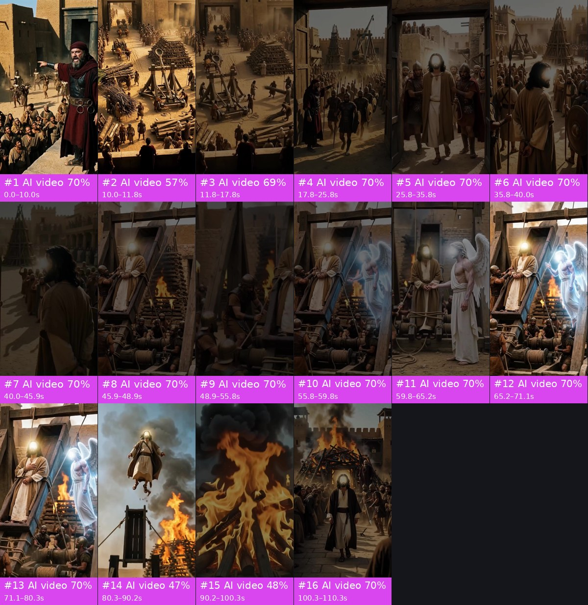
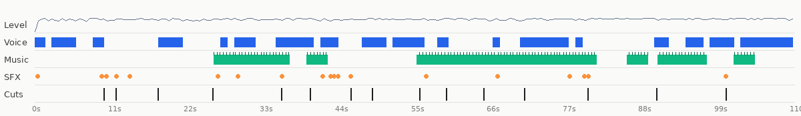

# How this video was made: midad.mp4

**How it was made**: Mixed production: live action or AI, to confirm 100%

- 1:50 · vertical 9:16 · 16 shots, 6.9s each on average
- Confidence 66%, based on: tool measurements
- ⚠️ **Nobody has looked at the picture yet**: live action / AI / 3D / code render come from pixel statistics only and are often wrong across the board after platform transcoding. Turn on a VLM or have an agent review the shots (`rea-video review`) before remaking from this report
- ⚠️ 19 points are uncertain, see “Open questions”

<!--mix-->



# Part one · Breakdown: how this video is built

## At a glance: picture, packaging, sound

Any short video splits into three layers: the picture, what is laid on top of it (subtitles, styled text, stickers), and the sound. Remake it one layer at a time.

| Layer | In this video | How to make it | Detail |
|---|---|---|---|
| **Picture** (base) | AI-generated video 16 shots | AI in 10 generations | “Remake it yourself” |
| **Packaging** (on top) | text, styled text, title, subtitle | add in the editor: subtitles, styled text and stickers by the timeline | “Packaging layer” |
| **Sound** | voice（native dialogue from the AI video model）, music (132 BPM, to confirm) | voice: generated with the AI video; music: find a track with the same tempo and mood | “Sound” |

## Content and structure

- The whole video's content was not analysed this time (needs AI image reading); subtitle text is under “Packaging layer”

- No narrative line this time (what each shot is doing in the story needs AI image reading); the “Picture” column of the shot list is a start

## Shot list

| # | Frame | Time | Picture | Camera |
|---|---|---|---|---|
| 1 |  | 0:00.0 · 10.0s | — | smooth move |
| 2 |  | 0:10.0 · 1.8s | — | smooth move |
| 3 |  | 0:11.8 · 6.1s | — | smooth move |
| 4 |  | 0:17.8 · 8.0s | — | smooth move |
| 5 |  | 0:25.8 · 10.0s | — | smooth move |
| 6 |  | 0:35.8 · 4.2s | — | smooth move |
| 7 |  | 0:40.0 · 5.9s | — | smooth move |
| 8 |  | 0:45.9 · 3.1s | — | smooth move |
| 9 |  | 0:48.9 · 6.9s | — | smooth move |
| 10 |  | 0:55.8 · 3.9s | — | smooth move |
| 11 |  | 0:59.8 · 5.4s | — | smooth move |
| 12 |  | 1:05.2 · 5.9s | — | smooth move |
| 13 |  | 1:11.1 · 9.2s | — | smooth move |
| 14 |  | 1:20.3 · 10.0s | — | smooth move |
| 15 |  | 1:30.2 · 10.1s | — | static (subject moves) |
| 16 |  | 1:40.3 · 9.9s | — | smooth move |

## Cast, scenes and props

- No cast extracted this time (needs AI image reading); shots where the face detector saw a face (person or character): #1, #8, #10, #12, #13

## Camera and lighting

- Framing: shot size medium close-up 58%, medium shot 36%, close-up 6%; subject is the in-focus region (no face; shot size is an estimate)
- Camera: moving camera (gimbal / handheld pan) 91%, fixed camera (tripod / mount / on the desk) 9%; typical move push-in
- Lighting: soft frontal light (flat light). Key light frontal (from the camera side; both sides of the subject about equally bright), at subject height; lighting ratio about 1.3:1 (0.4 stops); soft light (wide lit-to-shadow ramp); colour temperature warm (about 3000–4000K); background slightly soft
- (not live footage: the above describes the light in the picture, for generation prompts, not a shooting plan)
- Grade: vivid, high saturation; high saturation, normal contrast, normal blacks, overall warm

<details class="ref"><summary>Per-item measurements and image readings (5)</summary>

| Aspect | Item | Verdict | Sources |
|---|---|---|---|
| Framing | shot size | medium close-up | measured |
| Camera | camera support | moving camera (gimbal / handheld pan) | measured |
| Lighting | soft / hard | soft light (wide lit-to-shadow ramp) | measured |
| Lighting | colour temperature | warm (about 3000–4000K) | measured |
| Grade | colour grade | vivid, high saturation | measured |

- Note: lighting ratio, soft / hard, colour temperature and shot size are measured on the subject's pixels (the face when there is one, otherwise the in-focus region, which is an estimate); platform transcodes crush the shadows, so hardness and fill read conservative; camera angle, light source, catchlight and rim light follow the image readers. Where measurement and readers disagree, both are listed.

</details>

## Packaging layer (subtitles / styled text / stickers / sound-effect hits)

- styled text ×4 (large size, tilted, orange fill, brown fill, multi-colour / gradient, thick outline): "2", "mmn", "Q", "1"
- text label ×12 (1 of them follow an object): "1", "777", "X", "希", "F", "和" …

<details class="ref"><summary>text timeline (16 rows)</summary>

| Time | Kind | Text | Style | In / out | SFX |
|---|---|---|---|---|---|
| 2.50–2.60s | text label | 1 | brown text, line height 6.0% (about 116px) | hard in / hard out | — |
| 4.80–5.30s | styled text | 2 | orange text, orange outline, line height 20.9% (about 401px) | hard in / hard out | — |
| 7.50–8.60s | text label · follows an object | 777 | brown text, brown outline, keywords highlighted in orange, line height 18.2% (about 349px) | fade in / fade out | — |
| 35.00–35.10s | text label | X | orange text, line height 4.5% (about 87px) | hard in / hard out | — |
| 35.40–35.70s | text label | 希 | grey text, black outline, line height 8.6% (about 165px) | fade in / hard out | — |
| 41.00–41.10s | styled text | mmn | brown text, line height 3.6% (about 69px) | hard in / hard out | — |
| 48.50–48.60s | text label | F | brown text, brown outline, line height 13.0% (about 249px) | hard in / hard out | — |
| 53.50–55.70s | text label | 和 | brown text, orange outline, keywords highlighted in orange, line height 56.5% (about 1084px) | hard out | — |
| 62.50–62.60s | text label | 4 | orange text, line height 8.6% (about 165px) | hard in / hard out | — |
| 68.50–68.60s | text label | 2 | orange text, orange outline, line height 7.0% (about 135px) | hard in / hard out | — |
| 70.00–70.60s | text label | e | orange text, orange outline, keywords highlighted in brown, line height 7.3% (about 141px) | fade in / fade out | — |
| 71.00–71.10s | text label | a | orange text, orange outline, line height 8.8% (about 170px) | hard in / hard out | — |
| 75.40–76.90s | styled text | Q | brown text, brown outline, keywords highlighted in white, line height 35.5% (about 681px) | fade in / fade out | — |
| 82.80–83.40s | text label | C | brown text, line height 10.3% (about 198px) | hard in / hard out | — |
| 84.40–84.70s | styled text | 1 | brown text, black outline, line height 2.6% (about 50px) | type-on / hard out | — |
| 86.30–87.10s | text label | XC | brown text, brown outline, keywords highlighted in orange, line height 48.8% (about 936px) | hard in / fade out | — |

</details>

- Remake: import `packaging/subtitles.srt` into your editor and put in your own words; the styled version is `packaging/overlays.ass`

## Sound

**Voice**

- female-leaning; sung
- Source: native dialogue from the AI video model
- Remake: generated with the AI video: use a video model that speaks, with the lines in the prompt

**Music**

- Tempo: 132 BPM; F major; ending: ends before the video
- Source: to confirm
- Remake: The original track leans stock library music: search a library by BPM / mood / key for a similar track, or generate a royalty-free track in a similar style with AI

**Listen to the tracks**

<!--stems-->

<details class="ref"><summary>Sound measurements and evidence</summary>



- Loudness -14.4 dBFS, peak 0.0 dBFS
- each clip carries its own sound (background jumps 8.4dB at cuts vs 2.9dB within shots)
- Voice on 51% of the duration, pitch about 227.3Hz
- Voice source: native dialogue from the AI video model (native dialogue from the AI video model 65%, TTS voice-over 18%, human recording 18%)
  - The background sound jumps at every cut and the picture is AI video: the voice was most likely generated with the picture by the video model (e.g. Seedance / Veo / H3 native audio)
- tempo may also be 66.3/265.0 BPM; music on 48% of the duration (26.0–104.5s); section changes at 26.0s, 36.0s, 44.0s, 48.5s, 80.5s; 7% of cuts land on a beat (chance: about 15%)
- Music source: to confirm (stock library music 60%, AI-generated music 20%, well-known song 20%)
  - The music is a bed under the picture: in a regular video the bed usually comes from a stock library (prior)
  - Nothing about this track beyond the format prior and weak cues like the ending (no source heard, no platform music tag): source to confirm; an AI-generated bed cannot be told from a library bed here
  - How to confirm: Check the music tag on the original Douyin / Xiaohongshu / TikTok post: a song title → existing track; "original sound - @creator" → uploaded by the creator (for music videos, usually an AI song)
  - How to confirm: Run it through Shazam / ACRCloud or another song-ID service: a hit means an existing song

</details>

## Open questions

- The VLM did not run (No VLM; live action / AI / 3D are told apart from pixel statistics only, so confidence is limited. An agent that can see images: run rea-video review, look at each shot and merge with apply-review; otherwise configure a VLM (any OpenAI-compatible multimodal model, e.g. Gemini / GPT-4o / Doubao / Qwen-VL): set REA_VLM_BASE_URL, REA_VLM_API_KEY and REA_VLM_MODEL (several models comma-separated as fallbacks), then rerun with --vlm): live action / AI / 3D is decided by signal forensics alone; configure a multimodal model and rerun with --vlm, or have an agent review the frames
- Shot #1 (0.0–10.0s): AI, 24p camera footage or film / TV footage, to confirm: only frame-rate evidence (a 24fps source, which films and TV share) and no AIGC label, needs an image reader
- Shot #2 (10.0–11.8s): AI, 24p camera footage or film / TV footage, to confirm: only frame-rate evidence (a 24fps source, which films and TV share) and no AIGC label, needs an image reader
- Shot #3 (11.8–17.8s): AI, 24p camera footage or film / TV footage, to confirm: only frame-rate evidence (a 24fps source, which films and TV share) and no AIGC label, needs an image reader
- Shot #4 (17.8–25.8s): AI, 24p camera footage or film / TV footage, to confirm: only frame-rate evidence (a 24fps source, which films and TV share) and no AIGC label, needs an image reader
- Shot #5 (25.8–35.8s): AI, 24p camera footage or film / TV footage, to confirm: only frame-rate evidence (a 24fps source, which films and TV share) and no AIGC label, needs an image reader
- Shot #6 (35.8–40.0s): AI, 24p camera footage or film / TV footage, to confirm: only frame-rate evidence (a 24fps source, which films and TV share) and no AIGC label, needs an image reader
- Shot #7 (40.0–45.9s): AI, 24p camera footage or film / TV footage, to confirm: only frame-rate evidence (a 24fps source, which films and TV share) and no AIGC label, needs an image reader
- Shot #8 (45.9–48.9s): AI, 24p camera footage or film / TV footage, to confirm: only frame-rate evidence (a 24fps source, which films and TV share) and no AIGC label, needs an image reader
- Shot #9 (48.9–55.8s): AI, 24p camera footage or film / TV footage, to confirm: only frame-rate evidence (a 24fps source, which films and TV share) and no AIGC label, needs an image reader
- Shot #10 (55.8–59.8s): AI, 24p camera footage or film / TV footage, to confirm: only frame-rate evidence (a 24fps source, which films and TV share) and no AIGC label, needs an image reader
- Shot #11 (59.8–65.2s): AI, 24p camera footage or film / TV footage, to confirm: only frame-rate evidence (a 24fps source, which films and TV share) and no AIGC label, needs an image reader
- Shot #12 (65.2–71.1s): AI, 24p camera footage or film / TV footage, to confirm: only frame-rate evidence (a 24fps source, which films and TV share) and no AIGC label, needs an image reader
- Shot #13 (71.1–80.3s): AI, 24p camera footage or film / TV footage, to confirm: only frame-rate evidence (a 24fps source, which films and TV share) and no AIGC label, needs an image reader
- Shot #14 (80.3–90.2s): Live action / stop motion or AI, to confirm: no AIGC label; 24fps-source marks appear in AI video, stop motion and cinema-camera footage alike
- Shot #15 (90.2–100.3s): Live action / stop motion or AI, to confirm: no AIGC label; 24fps-source marks appear in AI video, stop motion and cinema-camera footage alike
- Shot #16 (100.3–110.3s): AI, 24p camera footage or film / TV footage, to confirm: only frame-rate evidence (a 24fps source, which films and TV share) and no AIGC label, needs an image reader
- No AI listened to the soundtrack: real voice versus TTS is inferred from the waveform; the effects were found on the separated effects track and their types are estimated from the sound. Play the stems and each effect under “Sound” to check
- music source to confirm: most likely stock library music (60%); how to check is under “Sound”

# Part two · Remake plan

Planned for **MiniMax H3 / H3 Max**: ≤15 s per call, several shots per call, takes reference video (3 clips, ≤15 s in all), ≤9 reference images, first / last frame, native sound. Name another model and the split, lengths and prompts are redone for it.

## Remake it yourself: do it in this order

Copy the method and the rhythm, not the pictures: keep what each part does and fill it with your own content and material.

This is a AI story short. Do the steps in this order; the detail for each is in the matching subsection below.

1. **Write the content**: one picture of your own for each of the 16 shots in the shot list
2. **Fill in the prompts**: this run had no image reading, so the shot descriptions in the units are empty; have the agent read the shots first
3. **Generate**: 10 calls (110 s), several shots each. Each shot gets one source frame for composition (subtitles erased, in `remake/refs/`), the swapped-in people, animals and products get reference images, and the prompt lists the shots in order; the original's dialogue was generated with the picture, so the lines go in the prompt
4. **Adapt the prompts to your model**: the prompts in this report are generic, and every model reads them differently (how shots are split, how references are addressed, how dialogue is written). Before generating, rewrite them following the official prompt guide of the model you actually use, or have the agent refine them with that model's prompting skill; notes for MiniMax H3 / H3 Max at the top of “AI generation”
5. **Edit**: follow the order and lengths in the shot list; the original has 16 shots at 6.9s each; 11 transitions under “Edit”
6. **Subtitles and styled text**: timing and style under “Packaging layer”
7. **Music**: find a track at the same tempo and mood (source: to confirm, about 132 BPM, F major)
8. **Put it together and compare**: hand the shots you made to the agent; it places them on the original timeline, keeps the original where yours are missing, and renders a side-by-side comparison with the original

### AI generation

**10 generations, 110 s in total**

> ⚠️ G1、G2、G3、G4、G5、G6、G7、G8、G9、G10: the prompts are still generic drafts. Rewrite them in MiniMax H3 / H3 Max's official format (or have the agent write them with that model's prompting skill) into `remake/prompts.json`, numbering images in the unit's reference order; `rea-video plan` then checks the format.

| Part | Shots | Time | Length | Prepare |
|---|---|---|---|---|
| G1 | #1, #2 | 0.0–11.8s | 11.8s | reference images |
| G2 | #3, #4 | 11.8–25.8s | 14.1s | reference images |
| G3 | #5 | 25.8–35.8s | 10.0s | reference images |
| G4 | #6–#8 | 35.8–48.9s | 13.1s | reference images |
| G5 | #9, #10 | 48.9–59.8s | 10.8s | reference images |
| G6 | #11, #12 | 59.8–71.1s | 11.3s | reference images |
| G7 | #13 | 71.1–80.3s | 9.2s | reference images |
| G8 | #14 | 80.3–90.2s | 10.0s | reference images |
| G9 | #15 | 90.2–100.3s | 10.1s | reference images |
| G10 | #16 | 100.3–110.3s | 9.9s | reference images |

<details class="ref"><summary>Why it is split this way</summary>

- Grouping: consecutive shots share a call where they fit, ≤15s per call, ≤4 shots; a long stretch is cut at a scene change first
- Inputs: the model takes no reference video: one source frame per shot (subtitles erased) fixes composition, swapped-in things get their own images
- Audio: the model can generate action sound effects and ambience along with the picture; the voice was recorded by a person: record it separately and mix it in rather than having the video model speak, so copy and timing stay editable
- Packaging: the text label, styled text on the generated shots is post-production packaging: keep it out of the prompts (erased from source references) and lay it back on from the packaging timeline after generation

</details>

<details><summary>G1 · shots #1, #2 · 11.8s</summary>

- reference images: source frames of shots #1、#2 (subtitles erased)

Draft prompt (generic; rewrite it in MiniMax H3 / H3 Max's format into remake/prompts.json before generating):

```text
Generate the shots below in order in one go, hard cuts between them; each shot takes composition, size and camera from its source frame image. Vertical 9:16; soft frontal light (flat light), soft light (wide lit-to-shadow ramp), warm (about 3000–4000K), background slightly soft. No subtitles, captions or watermarks in the picture.
Shot 1 (from 0.0s): (no description: write one in the image review) (composition: @图片1)
Shot 2 (from 10.0s): (no description: write one in the image review) (composition: @图片2)
```

</details>

<details><summary>G2 · shots #3, #4 · 14.1s</summary>

- reference images: source frames of shots #3、#4 (subtitles erased)

Draft prompt (generic; rewrite it in MiniMax H3 / H3 Max's format into remake/prompts.json before generating):

```text
Generate the shots below in order in one go, hard cuts between them; each shot takes composition, size and camera from its source frame image. Vertical 9:16; soft frontal light (flat light), soft light (wide lit-to-shadow ramp), warm (about 3000–4000K), background slightly soft. No subtitles, captions or watermarks in the picture.
Shot 1 (from 0.0s): (no description: write one in the image review) (composition: @图片1)
Shot 2 (from 6.1s): (no description: write one in the image review) (composition: @图片2)
```

</details>

<details><summary>G3 · shots #5 · 10.0s</summary>

- reference images: source frames of shots #5 (subtitles erased)

Draft prompt (generic; rewrite it in MiniMax H3 / H3 Max's format into remake/prompts.json before generating):

```text
Generate the shots below in order in one go, hard cuts between them; each shot takes composition, size and camera from its source frame image. Vertical 9:16; soft frontal light (flat light), soft light (wide lit-to-shadow ramp), warm (about 3000–4000K), background slightly soft. No subtitles, captions or watermarks in the picture.
(no description: write one in the image review) (composition: @图片1)
```

</details>

<details><summary>G4 · shots #6–#8 · 13.1s</summary>

- reference images: source frames of shots #6、#7、#8 (subtitles erased)

Draft prompt (generic; rewrite it in MiniMax H3 / H3 Max's format into remake/prompts.json before generating):

```text
Generate the shots below in order in one go, hard cuts between them; each shot takes composition, size and camera from its source frame image. Vertical 9:16; soft frontal light (flat light), soft light (wide lit-to-shadow ramp), warm (about 3000–4000K), background slightly soft. No subtitles, captions or watermarks in the picture.
Shot 1 (from 0.0s): (no description: write one in the image review) (composition: @图片1)
Shot 2 (from 4.2s): (no description: write one in the image review) (composition: @图片2)
Shot 3 (from 10.0s): (no description: write one in the image review) (composition: @图片3)
```

</details>

<details><summary>G5 · shots #9, #10 · 10.8s</summary>

- reference images: source frames of shots #9、#10 (subtitles erased)

Draft prompt (generic; rewrite it in MiniMax H3 / H3 Max's format into remake/prompts.json before generating):

```text
Generate the shots below in order in one go, hard cuts between them; each shot takes composition, size and camera from its source frame image. Vertical 9:16; soft frontal light (flat light), soft light (wide lit-to-shadow ramp), warm (about 3000–4000K), background slightly soft. No subtitles, captions or watermarks in the picture.
Shot 1 (from 0.0s): (no description: write one in the image review) (composition: @图片1)
Shot 2 (from 6.9s): (no description: write one in the image review) (composition: @图片2)
```

</details>

<details><summary>G6 · shots #11, #12 · 11.3s</summary>

- reference images: source frames of shots #11、#12 (subtitles erased)

Draft prompt (generic; rewrite it in MiniMax H3 / H3 Max's format into remake/prompts.json before generating):

```text
Generate the shots below in order in one go, hard cuts between them; each shot takes composition, size and camera from its source frame image. Vertical 9:16; soft frontal light (flat light), soft light (wide lit-to-shadow ramp), warm (about 3000–4000K), background slightly soft. No subtitles, captions or watermarks in the picture.
Shot 1 (from 0.0s): (no description: write one in the image review) (composition: @图片1)
Shot 2 (from 5.4s): (no description: write one in the image review) (composition: @图片2)
```

</details>

<details><summary>G7 · shots #13 · 9.2s</summary>

- reference images: source frames of shots #13 (subtitles erased)

Draft prompt (generic; rewrite it in MiniMax H3 / H3 Max's format into remake/prompts.json before generating):

```text
Generate the shots below in order in one go, hard cuts between them; each shot takes composition, size and camera from its source frame image. Vertical 9:16; soft frontal light (flat light), soft light (wide lit-to-shadow ramp), warm (about 3000–4000K), background slightly soft. No subtitles, captions or watermarks in the picture.
(no description: write one in the image review) (composition: @图片1)
```

</details>

<details><summary>G8 · shots #14 · 10.0s</summary>

- reference images: source frames of shots #14 (subtitles erased)

Draft prompt (generic; rewrite it in MiniMax H3 / H3 Max's format into remake/prompts.json before generating):

```text
Generate the shots below in order in one go, hard cuts between them; each shot takes composition, size and camera from its source frame image. Vertical 9:16; soft frontal light (flat light), soft light (wide lit-to-shadow ramp), warm (about 3000–4000K), background slightly soft. No subtitles, captions or watermarks in the picture.
(no description: write one in the image review) (composition: @图片1)
```

</details>

<details><summary>G9 · shots #15 · 10.1s</summary>

- reference images: source frames of shots #15 (subtitles erased)

Draft prompt (generic; rewrite it in MiniMax H3 / H3 Max's format into remake/prompts.json before generating):

```text
Generate the shots below in order in one go, hard cuts between them; each shot takes composition, size and camera from its source frame image. Vertical 9:16; soft frontal light (flat light), soft light (wide lit-to-shadow ramp), warm (about 3000–4000K), background slightly soft. No subtitles, captions or watermarks in the picture.
(no description: write one in the image review) (composition: @图片1)
```

</details>

<details><summary>G10 · shots #16 · 9.9s</summary>

- reference images: source frames of shots #16 (subtitles erased)

Draft prompt (generic; rewrite it in MiniMax H3 / H3 Max's format into remake/prompts.json before generating):

```text
Generate the shots below in order in one go, hard cuts between them; each shot takes composition, size and camera from its source frame image. Vertical 9:16; soft frontal light (flat light), soft light (wide lit-to-shadow ramp), warm (about 3000–4000K), background slightly soft. No subtitles, captions or watermarks in the picture.
(no description: write one in the image review) (composition: @图片1)
```

</details>

### Edit

- Cut in the order and lengths of the shot list
- Rhythm: 8.2 cuts per minute, 6.89s average shot; no live-action shots; transitions blur transition×1, cut×4, fade×10

**Transitions**

| Time | Into shot | Transition |
|---|---|---|
| 11.5–11.9s | #3 | fade, through black, 0.4s |
| 17.6–18.0s | #4 | fade, through black, 0.4s |
| 25.6–26.0s | #5 | fade, through black, 0.4s |
| 35.6–36.0s | #6 | fade, through black, 0.4s |
| 39.9–40.2s | #7 | fade, through black, 0.3s |
| 45.6–46.0s | #8 | fade, through black, 0.4s |
| 48.9–49.2s | #9 | blur transition, 0.3s |
| 55.6–56.0s | #10 | fade, through black, 0.4s |
| 59.6–59.9s | #11 | fade, through black, 0.4s |
| 90.0–90.3s | #15 | fade, through black, 0.3s |
| 100.1–100.5s | #16 | fade, through black, 0.4s |

## Appendix

### Shot by shot

Each shot has two parts: what is visible on screen, and how the tools infer it was made (with the basis); remake prompts last. Folded by default.

<details class="ref"><summary>#1 00:00.000–00:10.000 · AI-generated video + code / editor overlays (text labels, styled text)</summary>


**Visible on screen** (check against the frames)
- Camera / lighting: medium close-up; moving camera (gimbal / handheld pan); night / low-light ambient, no dedicated fill; key light frame left, three-quarter front; lighting ratio about 1.5:1 (0.6 stops); hard light (sharp shadow edge)
- Text track (text/bottom): 1
- Text track (text/bottom): 2
- Text track (text/middle): 77
- Text track (title/top): 777

**How it was made, as inferred by the tools** (inferred, not seen)
- Inference: AI-generated video 82%, AI avatar (talking head) 8%, 3D render 3% (deterministic)
- ⚠️ To confirm: AI, 24p camera footage or film / TV footage, to confirm: only frame-rate evidence (a 24fps source, which films and TV share) and no AIGC label, needs an image reader
- Material: AI-generated
- Basis (tool measurements, not necessarily visible to the eye):
  - Low-light shot: 24% of the frame is near-black but grainy (not a solid fill), flat blocks cover only 3% of the lit part, and there is a face: the flat blocks / small palette come from crushed shadows, not counted as rendered texture
  - Photographic texture: noise σ=0.38, 109 colours, 3% flat blocks
  - Duplicate frames follow a 24→30 pattern (20%, period 5): a 24/25fps source transcoded up, typical of AI-generated video, 3D / animation renders or cinema footage

- Remake: Source is AI-generated: remake it with a video model; which shots share a call and what it is fed (the source clip, keyframes or first / last frames) depend on the chosen model, see the generation units in the remake plan

</details>

<details class="ref"><summary>#2 00:10.000–00:11.767 · AI-generated video</summary>


**Visible on screen** (check against the frames)
- Camera / lighting: medium close-up; moving camera (gimbal / handheld pan); coloured ambient light (RGB lights / neon); key light frame right, three-quarter front; lighting ratio about 1.6:1 (0.7 stops); medium-soft

**How it was made, as inferred by the tools** (inferred, not seen)
- Inference: AI-generated video 57%, live action 26%, 3D render 9% (deterministic)
- ⚠️ To confirm: AI, 24p camera footage or film / TV footage, to confirm: only frame-rate evidence (a 24fps source, which films and TV share) and no AIGC label, needs an image reader
- Material: AI-generated
- Basis (tool measurements, not necessarily visible to the eye):
  - Photographic texture: noise σ=1.47, 94 colours, 5% flat blocks
  - Duplicate frames follow a 24→30 pattern (17%, period 5): a 24/25fps source transcoded up, typical of AI-generated video, 3D / animation renders or cinema footage

- Remake: Source is AI-generated: remake it with a video model; which shots share a call and what it is fed (the source clip, keyframes or first / last frames) depend on the chosen model, see the generation units in the remake plan

</details>

<details class="ref"><summary>#3 00:11.767–00:17.833 · AI-generated video</summary>


**Visible on screen** (check against the frames)
- Camera / lighting: close-up; moving camera (gimbal / handheld pan); coloured ambient light (RGB lights / neon); key light frontal (from the camera side; both sides of the subject about equally bright); lighting ratio about 1.1:1 (0.2 stops); soft light (almost no lit / shadow edge)

**How it was made, as inferred by the tools** (inferred, not seen)
- Inference: AI-generated video 69%, 3D render 18%, code / template render 4% (deterministic)
- ⚠️ To confirm: AI, 24p camera footage or film / TV footage, to confirm: only frame-rate evidence (a 24fps source, which films and TV share) and no AIGC label, needs an image reader
- Material: AI-generated
- Basis (tool measurements, not necessarily visible to the eye):
  - Photographic texture: noise σ=0.57, 71 colours, 6% flat blocks
  - Duplicate frames follow a 24→30 pattern (18%, period 5): a 24/25fps source transcoded up, typical of AI-generated video, 3D / animation renders or cinema footage

- Remake: Source is AI-generated: remake it with a video model; which shots share a call and what it is fed (the source clip, keyframes or first / last frames) depend on the chosen model, see the generation units in the remake plan

</details>

<details class="ref"><summary>#4 00:17.833–00:25.833 · AI-generated video</summary>


**Visible on screen** (check against the frames)
- Camera / lighting: medium close-up; moving camera (gimbal / handheld pan); soft frontal light (flat light); key light frontal (from the camera side; both sides of the subject about equally bright); lighting ratio about 1.2:1 (0.2 stops); hard light (sharp shadow edge)

**How it was made, as inferred by the tools** (inferred, not seen)
- Inference: AI-generated video 71%, 3D render 18%, code / template render 4% (deterministic)
- ⚠️ To confirm: AI, 24p camera footage or film / TV footage, to confirm: only frame-rate evidence (a 24fps source, which films and TV share) and no AIGC label, needs an image reader
- Material: AI-generated
- Basis (tool measurements, not necessarily visible to the eye):
  - Photographic texture: noise σ=0.38, 78 colours, 4% flat blocks
  - Duplicate frames follow a 24→30 pattern (19%, period 5): a 24/25fps source transcoded up, typical of AI-generated video, 3D / animation renders or cinema footage

- Remake: Source is AI-generated: remake it with a video model; which shots share a call and what it is fed (the source clip, keyframes or first / last frames) depend on the chosen model, see the generation units in the remake plan

</details>

<details class="ref"><summary>#5 00:25.833–00:35.833 · AI-generated video + code / editor overlays (title)</summary>


**Visible on screen** (check against the frames)
- Camera / lighting: medium shot; moving camera (gimbal / handheld pan); three-quarter key + fill (standard set-up); key light frame right, three-quarter front; lighting ratio about 2.0:1 (1.0 stops); soft light (wide lit-to-shadow ramp)
- Text track (text/bottom): X
- Text track (title/top): 希

**How it was made, as inferred by the tools** (inferred, not seen)
- Inference: AI-generated video 75%, 3D render 15%, code / template render 3% (deterministic)
- ⚠️ To confirm: AI, 24p camera footage or film / TV footage, to confirm: only frame-rate evidence (a 24fps source, which films and TV share) and no AIGC label, needs an image reader
- Material: AI-generated
- Basis (tool measurements, not necessarily visible to the eye):
  - Photographic texture: noise σ=0.30, 78 colours, 6% flat blocks
  - Duplicate frames follow a 24→30 pattern (20%, period 5): a 24/25fps source transcoded up, typical of AI-generated video, 3D / animation renders or cinema footage

- Remake: Source is AI-generated: remake it with a video model; which shots share a call and what it is fed (the source clip, keyframes or first / last frames) depend on the chosen model, see the generation units in the remake plan

</details>

<details class="ref"><summary>#6 00:35.833–00:40.000 · AI-generated video</summary>


**Visible on screen** (check against the frames)
- Camera / lighting: medium shot; moving camera (gimbal / handheld pan); three-quarter key + fill (standard set-up); key light frame right, three-quarter front; lighting ratio about 1.4:1 (0.5 stops); soft light (wide lit-to-shadow ramp)

**How it was made, as inferred by the tools** (inferred, not seen)
- Inference: AI-generated video 79%, 3D render 10%, live action 3% (deterministic)
- ⚠️ To confirm: AI, 24p camera footage or film / TV footage, to confirm: only frame-rate evidence (a 24fps source, which films and TV share) and no AIGC label, needs an image reader
- Material: AI-generated
- Basis (tool measurements, not necessarily visible to the eye):
  - Photographic texture: noise σ=0.48, 88 colours, 4% flat blocks
  - Duplicate frames follow a 24→30 pattern (18%, period 5): a 24/25fps source transcoded up, typical of AI-generated video, 3D / animation renders or cinema footage

- Remake: Source is AI-generated: remake it with a video model; which shots share a call and what it is fed (the source clip, keyframes or first / last frames) depend on the chosen model, see the generation units in the remake plan

</details>

<details class="ref"><summary>#7 00:40.000–00:45.867 · AI-generated video + code / editor overlays (styled text)</summary>


**Visible on screen** (check against the frames)
- Camera / lighting: medium close-up; moving camera (gimbal / handheld pan); single side key, very little fill (high contrast); key light frame left (side light); lighting ratio about 3.0:1 (1.6 stops); soft light (wide lit-to-shadow ramp)
- Text track (text/middle): mmn

**How it was made, as inferred by the tools** (inferred, not seen)
- Inference: AI-generated video 75%, 3D render 14%, code / template render 3% (deterministic)
- ⚠️ To confirm: AI, 24p camera footage or film / TV footage, to confirm: only frame-rate evidence (a 24fps source, which films and TV share) and no AIGC label, needs an image reader
- Material: AI-generated
- Basis (tool measurements, not necessarily visible to the eye):
  - Photographic texture: noise σ=0.42, 77 colours, 6% flat blocks
  - Duplicate frames follow a 24→30 pattern (18%, period 5): a 24/25fps source transcoded up, typical of AI-generated video, 3D / animation renders or cinema footage

- Remake: Source is AI-generated: remake it with a video model; which shots share a call and what it is fed (the source clip, keyframes or first / last frames) depend on the chosen model, see the generation units in the remake plan

</details>

<details class="ref"><summary>#8 00:45.867–00:48.933 · AI-generated video + code / editor overlays (title)</summary>


**Visible on screen** (check against the frames)
- Camera / lighting: medium close-up; moving camera (gimbal / handheld pan); three-quarter key + fill (standard set-up); key light frame left, three-quarter front; lighting ratio about 2.4:1 (1.2 stops); soft light (wide lit-to-shadow ramp)
- Text track (title/top): F

**How it was made, as inferred by the tools** (inferred, not seen)
- Inference: AI-generated video 78%, AI avatar (talking head) 7%, live action 5% (deterministic)
- ⚠️ To confirm: AI, 24p camera footage or film / TV footage, to confirm: only frame-rate evidence (a 24fps source, which films and TV share) and no AIGC label, needs an image reader
- Material: AI-generated
- Basis (tool measurements, not necessarily visible to the eye):
  - Photographic texture: noise σ=0.60, 112 colours, 1% flat blocks
  - Duplicate frames follow a 24→30 pattern (20%, period 5): a 24/25fps source transcoded up, typical of AI-generated video, 3D / animation renders or cinema footage

- Remake: Source is AI-generated: remake it with a video model; which shots share a call and what it is fed (the source clip, keyframes or first / last frames) depend on the chosen model, see the generation units in the remake plan

</details>

<details class="ref"><summary>#9 00:48.933–00:55.833 · AI-generated video</summary>


**Visible on screen** (check against the frames)
- Camera / lighting: medium close-up; moving camera (gimbal / handheld pan); soft frontal light (flat light); key light frontal (from the camera side; both sides of the subject about equally bright); lighting ratio about 1.3:1 (0.4 stops); soft light (wide lit-to-shadow ramp)
- Text track (text/middle): 和

**How it was made, as inferred by the tools** (inferred, not seen)
- Inference: AI-generated video 80%, 3D render 9%, live action 3% (deterministic)
- ⚠️ To confirm: AI, 24p camera footage or film / TV footage, to confirm: only frame-rate evidence (a 24fps source, which films and TV share) and no AIGC label, needs an image reader
- Material: AI-generated
- Basis (tool measurements, not necessarily visible to the eye):
  - Photographic texture: noise σ=0.43, 87 colours, 2% flat blocks
  - Duplicate frames follow a 24→30 pattern (26%, period 5): a 24/25fps source transcoded up, typical of AI-generated video, 3D / animation renders or cinema footage

- Remake: Source is AI-generated: remake it with a video model; which shots share a call and what it is fed (the source clip, keyframes or first / last frames) depend on the chosen model, see the generation units in the remake plan

</details>

<details class="ref"><summary>#10 00:55.833–00:59.767 · AI-generated video</summary>


**Visible on screen** (check against the frames)
- Camera / lighting: medium close-up; moving camera (gimbal / handheld pan); three-quarter key + fill (standard set-up); key light frame left, three-quarter front; lighting ratio about 1.7:1 (0.8 stops); soft light (wide lit-to-shadow ramp)

**How it was made, as inferred by the tools** (inferred, not seen)
- Inference: AI-generated video 81%, AI avatar (talking head) 8%, live action 4% (deterministic)
- ⚠️ To confirm: AI, 24p camera footage or film / TV footage, to confirm: only frame-rate evidence (a 24fps source, which films and TV share) and no AIGC label, needs an image reader
- Material: AI-generated
- Basis (tool measurements, not necessarily visible to the eye):
  - Photographic texture: noise σ=0.53, 140 colours, 1% flat blocks
  - Duplicate frames follow a 24→30 pattern (18%, period 5): a 24/25fps source transcoded up, typical of AI-generated video, 3D / animation renders or cinema footage

- Remake: Source is AI-generated: remake it with a video model; which shots share a call and what it is fed (the source clip, keyframes or first / last frames) depend on the chosen model, see the generation units in the remake plan

</details>

<details class="ref"><summary>#11 00:59.767–01:05.200 · AI-generated video + code / editor overlays (title)</summary>


**Visible on screen** (check against the frames)
- Camera / lighting: medium shot; moving camera (gimbal / handheld pan); soft frontal light (flat light); key light frontal (from the camera side; both sides of the subject about equally bright); lighting ratio about 1.1:1 (0.1 stops); soft light (almost no lit / shadow edge)
- Text track (title/top): 4

**How it was made, as inferred by the tools** (inferred, not seen)
- Inference: AI-generated video 84%, live action 5%, 3D render 3% (deterministic)
- ⚠️ To confirm: AI, 24p camera footage or film / TV footage, to confirm: only frame-rate evidence (a 24fps source, which films and TV share) and no AIGC label, needs an image reader
- Material: AI-generated
- Basis (tool measurements, not necessarily visible to the eye):
  - Photographic texture: noise σ=0.64, 126 colours, 0% flat blocks
  - Duplicate frames follow a 24→30 pattern (20%, period 5): a 24/25fps source transcoded up, typical of AI-generated video, 3D / animation renders or cinema footage

- Remake: Source is AI-generated: remake it with a video model; which shots share a call and what it is fed (the source clip, keyframes or first / last frames) depend on the chosen model, see the generation units in the remake plan

</details>

<details class="ref"><summary>#12 01:05.200–01:11.067 · AI-generated video + code / editor overlays (subtitles)</summary>


**Visible on screen** (check against the frames)
- Camera / lighting: medium close-up; moving camera (gimbal / handheld pan); three-quarter key + fill (standard set-up); key light frame left, three-quarter front; lighting ratio about 1.8:1 (0.8 stops); soft light (wide lit-to-shadow ramp)
- Text track (subtitle/middle): 2 / e / a

**How it was made, as inferred by the tools** (inferred, not seen)
- Inference: AI-generated video 79%, AI avatar (talking head) 8%, live action 7% (deterministic)
- ⚠️ To confirm: AI, 24p camera footage or film / TV footage, to confirm: only frame-rate evidence (a 24fps source, which films and TV share) and no AIGC label, needs an image reader
- Material: AI-generated
- Basis (tool measurements, not necessarily visible to the eye):
  - Photographic texture: noise σ=0.67, 172 colours, 1% flat blocks
  - Duplicate frames follow a 24→30 pattern (20%, period 5): a 24/25fps source transcoded up, typical of AI-generated video, 3D / animation renders or cinema footage

- Remake: Source is AI-generated: remake it with a video model; which shots share a call and what it is fed (the source clip, keyframes or first / last frames) depend on the chosen model, see the generation units in the remake plan

</details>

<details class="ref"><summary>#13 01:11.067–01:20.267 · AI-generated video + code / editor overlays (styled text)</summary>


**Visible on screen** (check against the frames)
- Camera / lighting: medium close-up; moving camera (gimbal / handheld pan); soft frontal light (flat light); key light frontal (from the camera side; both sides of the subject about equally bright); lighting ratio about 1.3:1 (0.4 stops); soft light (almost no lit / shadow edge)
- Text track (text/middle): Q

**How it was made, as inferred by the tools** (inferred, not seen)
- Inference: AI-generated video 87%, live action 4%, 3D render 2% (deterministic)
- ⚠️ To confirm: AI, 24p camera footage or film / TV footage, to confirm: only frame-rate evidence (a 24fps source, which films and TV share) and no AIGC label, needs an image reader
- Material: AI-generated
- Basis (tool measurements, not necessarily visible to the eye):
  - Photographic texture: noise σ=0.49, 158 colours, 1% flat blocks
  - Duplicate frames follow a 24→30 pattern (20%, period 5): a 24/25fps source transcoded up, typical of AI-generated video, 3D / animation renders or cinema footage

- Remake: Source is AI-generated: remake it with a video model; which shots share a call and what it is fed (the source clip, keyframes or first / last frames) depend on the chosen model, see the generation units in the remake plan

</details>

<details class="ref"><summary>#14 01:20.267–01:30.233 · AI-generated video + code / editor overlays (text labels, styled text)</summary>


**Visible on screen** (check against the frames)
- Camera / lighting: medium shot; moving camera (gimbal / handheld pan); soft frontal light (flat light); key light frontal (from the camera side; both sides of the subject about equally bright); lighting ratio about 1.3:1 (0.3 stops); soft light (wide lit-to-shadow ramp)
- Text track (text/bottom): XC
- Text track (text/middle): C
- Text track (text/middle): 1

**How it was made, as inferred by the tools** (inferred, not seen)
- Inference: AI-generated video 47%, live action 38%, 3D render 5% (deterministic)
- ⚠️ To confirm: Live action / stop motion or AI, to confirm: no AIGC label; 24fps-source marks appear in AI video, stop motion and cinema-camera footage alike
- Material: AI-generated
- Basis (tool measurements, not necessarily visible to the eye):
  - Photographic texture: noise σ=0.21, 160 colours, 9% flat blocks
  - Platform transcode (YouTube) has compressed the sensor noise away: noise cues no longer apply, live action vs AI rests on frame rate and picture content

- Remake: Source is AI-generated: remake it with a video model; which shots share a call and what it is fed (the source clip, keyframes or first / last frames) depend on the chosen model, see the generation units in the remake plan

</details>

<details class="ref"><summary>#15 01:30.233–01:40.333 · AI-generated video</summary>


**Visible on screen** (check against the frames)
- Camera / lighting: medium shot; fixed camera (tripod / mount / on the desk); coloured ambient light (RGB lights / neon); key light frontal (from the camera side; both sides of the subject about equally bright); lighting ratio about 1.2:1 (0.3 stops); soft light (wide lit-to-shadow ramp)

**How it was made, as inferred by the tools** (inferred, not seen)
- Inference: AI-generated video 48%, live action 39%, 3D render 3% (deterministic)
- ⚠️ To confirm: Live action / stop motion or AI, to confirm: no AIGC label; 24fps-source marks appear in AI video, stop motion and cinema-camera footage alike
- Material: AI-generated
- Basis (tool measurements, not necessarily visible to the eye):
  - Photographic texture: noise σ=0.26, 143 colours, 4% flat blocks
  - Platform transcode (YouTube) has compressed the sensor noise away: noise cues no longer apply, live action vs AI rests on frame rate and picture content

- Remake: Source is AI-generated: remake it with a video model; which shots share a call and what it is fed (the source clip, keyframes or first / last frames) depend on the chosen model, see the generation units in the remake plan

</details>

<details class="ref"><summary>#16 01:40.333–01:50.267 · AI-generated video</summary>


**Visible on screen** (check against the frames)
- Camera / lighting: medium close-up; moving camera (gimbal / handheld pan); soft frontal light (flat light); key light frontal (from the camera side; both sides of the subject about equally bright); lighting ratio about 1.3:1 (0.4 stops); soft light (wide lit-to-shadow ramp)

**How it was made, as inferred by the tools** (inferred, not seen)
- Inference: AI-generated video 88%, 3D render 3%, live action 2% (deterministic)
- ⚠️ To confirm: AI, 24p camera footage or film / TV footage, to confirm: only frame-rate evidence (a 24fps source, which films and TV share) and no AIGC label, needs an image reader
- Material: AI-generated
- Basis (tool measurements, not necessarily visible to the eye):
  - Photographic texture: noise σ=0.35, 133 colours, 2% flat blocks
  - Duplicate frames follow a 24→30 pattern (20%, period 5): a 24/25fps source transcoded up, typical of AI-generated video, 3D / animation renders or cinema footage

- Remake: Source is AI-generated: remake it with a video model; which shots share a call and what it is fed (the source clip, keyframes or first / last frames) depend on the chosen model, see the generation units in the remake plan

</details>

### Metadata clues

- Encoder: `Lavf62.12.102`
- platform: YouTube

### Notes

- Deterministic forensics is reliable on motion, whole-frame pan/zoom, rendered texture and 24→30 fps conversion; telling live action from AI from 3D needs image reading (a VLM or an AI assistant's review), and a look at the frames yourself.
- Platform transcoding usually strips metadata; missing metadata proves nothing.
- The full data is in `breakdown.json`; the package for models starts at `VIDEO.md`.

---

Made with [REA-VIDEO](https://github.com/JuneYaooo/rea-video) · https://github.com/JuneYaooo/rea-video
